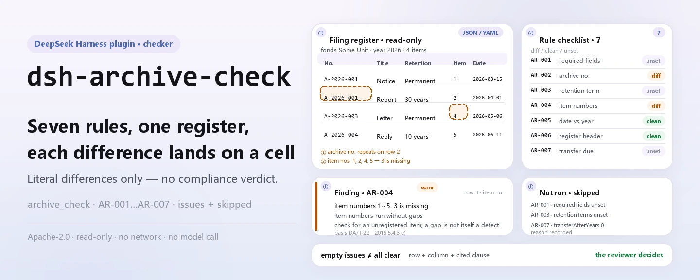
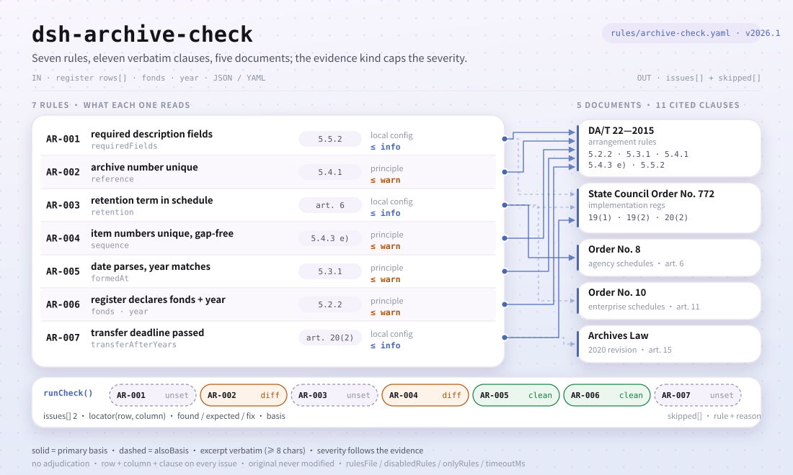

<div align="center">

<picture>
  <source media="(prefers-color-scheme: dark)" srcset="docs/assets/dsh-archive-check-hero-en-dark.webp">
  
</picture>

# dsh-archive-check

**Check every row of a filing register for complete description, unique archive numbers, gap-free item numbers, schedule-conform retention terms and parseable creation dates — and get back a list of what is inconsistent, where, and what to fix.**

An archive checker plugin for DeepSeek Harness, built for archivists and office clerks: the rule pack quotes its regulations verbatim, reports only literal differences against the cited clauses, and never decides compliance, never assigns liability, never touches your original.

[Install](#three-step-setup) · [Configuration](#configuration) · [FAQ](#faq) · [简体中文](README.md) · [English](README.en.md)

[](LICENSE)
[](#compatibility)
[](https://www.npmjs.com/package/dsh-archive-check)
[](https://github.com/PerryLink/dsh-archive-check/actions/workflows/ci.yml)
[](#compatibility)

[](https://github.com/PerryLink/dsh-archive-check/stargazers)
[](https://www.npmjs.com/package/dsh-archive-check)
[](https://dshfind.com/plugins/PerryLink/dsh-archive-check?ref=badge)
[](https://securityscorecards.dev/viewer/?uri=github.com/PerryLink/dsh-archive-check)
[](https://dsh.market/)
[](https://gitee.com/perrylink/dsh-archive-check)

```sh
dsh plugin --profile <name> add dsh-archive-check
```

</div>

<sub>Community plugin, not affiliated with DeepSeek. Canonical repository: <https://github.com/PerryLink/dsh-archive-check> (Gitee is a mirror).</sub>

## What it is

`dsh-archive-check` reads one filing register — the items with the columns the register carries, plus the fonds and the year it covers — and checks what a register can be held to mechanically: that each item carries the description fields you configure, that the archive number is unique within the register, that item numbers run without gaps, that the retention period uses a term from your own schedule, that the creation date parses and matches the register's year, and that items past the transfer deadline you configure are surfaced. You hand it the source material (a table, register or document; Excel can be converted to JSON/YAML first, in chat if the platform supports it) and it returns a list of differences. It does not decide compliance, does not assign liability, does not replace the reviewer — and it never modifies the original.

<picture>
  <source media="(prefers-color-scheme: dark)" srcset="docs/assets/dsh-archive-check-flow-v5-dark.svg">
  
</picture>

## Three-step setup

1. **Install**:

   ```sh
   dsh plugin --profile <name> add dsh-archive-check
   ```

   Alternatively, search "Professional Document Check Suite" in WorkBuddy / Coze (the full set; this check is one part of it; availability as listed).

2. **Minimal config** (works out of the box):

   ```yaml
   - insert:
       - id: dsh-archive-check
         name: dsh-archive-check
   ```

   Every tunable lives in the Schemastery schema in `src/config.ts` and the defaults are production-ready; per-rule thresholds live in the rule pack under `rules/`.

3. **Verify it mounts**:

   ```sh
   dsh --profile <name> --dump-config | grep 'dsh-archive-check'
   ```

   Then run the bundled sample (about a minute):

   ```sh
   node samples/quickstart/run.mjs --check
   ```

   Sample input lives in `samples/quickstart/input/`, the expected output in `samples/quickstart/expected/result.json`, and a captured run in `docs/assets/quickstart.png`.

**Uninstall**: `dsh plugin --profile <name> remove dsh-archive-check` (or remove the row from the profile patch).

<details>
<summary>Install from the DSH Desktop market</summary>

Every PerryLink plugin is listed in the built-in DSH Desktop market: **Market → Sources → Add source → paste** `https://perrylink-dsh-catalog.perrylink.workers.dev/catalog-source.json` **→ select**. Installation still requires the market's npm identity check and your confirmation.

</details>

## Core capabilities

The plugin registers the `archive_check` tool: it reads one register (items plus the fonds and year it covers), applies a versioned rule pack, and returns a structured report.

- **The rule pack is data, not code** — every rule lives in `rules/archive-check.yaml`; swapping the file switches the rule set without touching TypeScript, and the pack is validated on load, not trusted.
- **Severity follows the evidence** — a rule resting on a general principle (`derived-from-principle`) is capped at `warn`; one resting on your institution's own configuration (`institutional-configuration`) is capped at `info`; neither can ever be declared `error` (a test asserts this).
- **An empty issue list is never "all clear"** — every check that could not run reports itself in `skipped` with its reason, and a rule whose required list is unset reports itself in `skipped` rather than passing silently.
- **No adjudication** — the report lists differences and never pronounces on compliance, liability or correctness; a wording guard forces the report to always carry the disclaimer.
- **Verbatim citations only** — every rule carries a document, a document number, a clause in the source's own numbering, a verbatim excerpt and the URL it was read from; an excerpt under eight characters or one that could not be obtained says so in the excerpt and marks the rule `derived-from-principle` — a paraphrase is never presented as a quotation.

```text
register (fonds · year · items) ──archive_check──▶ rule pack AR-001…AR-007 ──▶ report (findings + skipped)
            ▲                                                                              │
            └───────────────────────── original never modified ────────────────────────────┘
```

### Rules at a glance

| Rule | Check | Severity | Basis kind |
|---|---|---|---|
| `AR-001` | each item carries your required description fields (off by default) | info | local |
| `AR-002` | the archive number is unique within the register | warn | principle |
| `AR-003` | the retention period uses a term from your schedule (off by default) | info | local |
| `AR-004` | item numbers are unique and gap-free within the register | warn | principle |
| `AR-005` | the creation date parses, and its year matches the register's year | warn | principle |
| `AR-006` | the register declares its fonds and year | warn | principle |
| `AR-007` | items past your configured transfer deadline (off by default) | info | local |

### Examples

These are the plugin's real entry points; install once, then call one.

**Detailed output** — tool `archive_check`, input:

```json
{"fonds":"某单位","year":2026,"items":[{"档号":"A-2026-001","题名":"","保管期限":"永久", ...}]}
```

Output:

```json
{
  "id": "dsh-archive-check.AR-001.de09b5a6",
  "ruleId": "AR-001",
  "severity": "info",
  "locator": {
    "row": 1
  },
  "found": "第 1 行缺少 题名",
  "expected": "按本机构配置，归档条目应著录 档号、题名、保管期限",
  "fix": "补齐著录项目；本条只核对字段是否存在，不判断著录内容是否准确"
}
```

*Observed from `dsh-archive-check/tests/fixtures/AR-001/AR-001-unsafe.json; dsh-archive-check/tests/fixtures/AR-001/cases.json; dsh-archive-check/rules/archive-check.yaml; dsh-archive-check/tests/index.test.ts`*

### What it answers

| You ask | What it answers |
|---|---|
| I have configured no required description fields. Is the description check passing silently? | No. While `requiredFields` is empty, `AR-001` reports itself in `skipped`, so an empty difference list is not read as "nothing is missing". Once you list your own column names, it checks only that each field is filled on every item — an empty string counts as unfilled — and it does not judge whether the description is accurate. |
| Two items carry the same archive number, but one of them has a space in the middle. Is that still a duplicate? | Yes. `AR-002` compares archive numbers ignoring whitespace, so 「A-2026-001」 and 「A-2026- 001」 count as the same number. It is capped at `warn` because the clause it cites states uniqueness as a compilation principle rather than as a verbatim ban on duplicates in one register, and a hit usually means duplicate registration or a mistyped number that a person still has to confirm. |
| The retention-period column says something our schedule does not list. What does the check report? | `AR-003` keeps two cases apart: a value the parser cannot read as a retention term at all (the recognised wordings are listed in Material format), and a recognisable term that is not in the `retentionTerms` list you configure. The two need different corrections, so they are reported as different messages. The rule never decides which retention period a document deserves, and a period longer than the national framework is not an error — the provisions the pack cites make the enterprise figures a minimum. |
| The item numbers run 1, 2, 4 — is the missing 3 reported? | Yes, but only for item numbers written as pure digits: `AR-004` checks continuity only for those; an item number containing letters or spaces is left out of the comparison and reports no difference at all. A gap is not by itself a defect — the number may simply be unused — so a hit only asks you to confirm whether an item went unregistered. With `checkSequence: false` the rule does not run. |
| The creation date is written out in Chinese numerals. Will that be read? | No. `AR-005` reports it as "cannot parse", which is a different message from a date whose year disagrees with the register's year — the two point at different corrections. Filing across year boundaries is allowed, and the rule does not decide which year a document should be filed under. |
| How does the check know that a transfer is due? | `AR-007` compares each item's creation date with the `transferAfterYears` you configure and reports only whether that deadline has already passed under the years you set. The parameter ships as `0`, meaning unconfigured, so the rule reports itself in `skipped` until you set it; with `requireFormedAt: true`, items that have no creation date are reported separately, because no due date can be worked out from a missing date. The rule does not judge whether a transfer should be brought forward or postponed. |

## Configuration

Every tunable lives in the Schemastery schema in `src/config.ts`, so it can be changed from `cordis.yml` without editing code; per-rule thresholds live in the rule pack under `rules/`. The five keys below are the complete list; rule-level parameters follow.

| Key | Type | Default | Description |
|---|---|---|---|
| `rulesFile` | string | `rules/archive-check.yaml` | Rule-pack path, relative to the package root |
| `disabledRules` | string[] | `[]` | Rule ids to stop running; each appears in `skipped` |
| `onlyRules` | string[] | `[]` | Run only these rule ids; empty runs every rule |
| `skipNotes` | string | `""` | Note appended to every `skipped` reason |
| `timeoutMs` | number | `120000` | Cooperative tool timeout budget |

Rule-level parameters worth knowing:

- `AR-001` `requiredFields` — the columns a row must fill (a typical set is shown in the Material format glossary). Empty means the rule does not run. A blank cell counts as unfilled.
- `AR-003` `retentionTerms` — the terms your retention schedule uses; it can also be passed per call for a one-off comparison.
- `AR-004` `checkSequence` — set to `false` to stop checking item-number continuity.
- `AR-006` `requireHeader` — set to `false` if your register legitimately carries no fonds or year.
- `AR-007` `transferAfterYears` — **your** archive's transfer deadline: `20` for a central / provincial / sub-provincial receiving archive, `10` for a county-level one (per the cited implementation regulations). `0` means the rule does not run. `AR-007` `requireFormedAt` makes a missing creation-date column a finding rather than a skip, because the deadline cannot be computed without it.

## FAQ

<details>
<summary>Is my material modified or uploaded anywhere?</summary>

No. The tool only reads the JSON/YAML material text you hand it and **never modifies the original**; the plugin is plain ESM with no native code, **no network access and no model call** (see Compatibility), so the material never leaves your machine.

</details>

<details>
<summary>With no required fields or schedule configured, does anything pass silently?</summary>

No. Both lists — `AR-001` `requiredFields` and `AR-003` `retentionTerms` — ship empty, and a rule whose list is unset reports itself in `skipped` with the reason, so an empty difference list is never read as "nothing is missing". `AR-003` can also be fed per call for a one-off comparison without editing the rule pack.

</details>

<details>
<summary>The plugin installs but the tool never appears — what now?</summary>

Check that `main` resolves to `lib/index.mjs` and that `pnpm run build` produced it; a wrong `main` makes the loader skip the entry silently.

</details>

<details>
<summary>Install refused as version-incompatible — what now?</summary>

The peer range covers the `0.1.x` and `0.2.x` lines; if your runtime sits outside it, grant an explicit exemption: `dsh plugin --profile <name> allow-version dsh-archive-check@0.1.0 --dsh-version <runtime> --accept-risk`. Peer compatibility is enforced by the runtime at install time.

</details>

<details>
<summary>Can it handle a full year of registers or a whole directory in bulk?</summary>

The tool works in both `native` and `ptc` mode; for a year's worth of registers use `ptc`, so the schema cost is paid once. All arithmetic is wall-clock over the input strings, with no timezone conversion.

</details>

## Standards it follows

| Document | Number | Cited by rules |
|---|---|---|
| Arrangement rules for archival documents | DA/T 22—2015 | AR-001, AR-002, AR-004, AR-005, AR-006 |
| Implementation regulations of the Archives Law of the PRC | State Council Order No. 772 | AR-001, AR-003, AR-007 |
| Provisions on the filing scope and retention periods of agency records | State Archives Administration Order No. 8 | AR-003 |
| Provisions on the filing scope and retention periods of enterprise records | State Archives Administration Order No. 10 | AR-003 |
| Archives Law of the PRC | 2020 revision (Presidential Order No. 47) | AR-007 |

Original titles of the cited documents:

```text
《归档文件整理规则》 DA/T 22—2015
《中华人民共和国档案法实施条例》 国务院令第772号
《机关文件材料归档范围和文书档案保管期限规定》 国家档案局令第8号
《企业文件材料归档范围和档案保管期限规定》 国家档案局令第10号
《中华人民共和国档案法》 2020年修订（主席令第四十七号）
```

**Boundary:** this plugin checks one filing register for the things a register can be held to mechanically — that each item is described completely enough to be filed and found again, that the archive number is unique, that item numbers run without gaps, that retention terms come from your schedule, and that the creation date parses and matches the register's year. It does **not** decide whether a particular document belonged in the archive, nor which retention period it deserves. Those are the archivist's judgements.

> ### ⚠️ Three things this plugin refuses to do, and why
>
> **1. It never decides which retention period a document deserves.** There is **no single national
> retention table** you can apply. The implementation regulations (Article 19, paragraph 2) and
> Order No. 8 (Article 12) require each institution to compile its own filing scope and retention
> schedule and have it approved by the archives authority; and Order No. 10 (Article 11) says the
> enterprise figures are a **minimum** — an enterprise may lawfully choose a *longer* period. So
> `AR-003` checks only that the wording is one you have configured, and a test asserts that the
> pack says a longer period "is not an error".
>
> **2. It puts the transfer years where they belong.** The 20-year / 10-year figures are in the
> implementation regulations (Article 20, paragraph 2), keyed to the *receiving archive's level*,
> not to whether the unit is an enterprise. Article 15 of the Archives Law contains **no year
> figure at all** — it says only "in accordance with relevant state provisions, periodically".
> Attributing "20 years" to Article 15 would be fabrication, and a test asserts the pack does not.
>
> **3. It does not use the outdated first article.** Order No. 8's Article 1 cites the 1999
> implementation measures, which the 2024 regulations (State Council Order No. 772) repealed in
> their Article 52. The pack never cites it, and a test asserts that.
>
> Two lists are yours, not the law's: the required description fields (`AR-001`) and your retention
> vocabulary (`AR-003`). Both ship **empty**, and a rule whose list is unset reports itself in
> `skipped` rather than passing silently.

## Material format

The tool accepts JSON or YAML:

```yaml
fonds: 某单位
year: 2026
items:
  - { 档号: A-2026-001, 题名: 关于第一项工作的通知, 保管期限: 永久,   形成日期: 2026-03-15, 件号: "1" }
  - { 档号: A-2026-002, 题名: 关于第二项工作的通知, 保管期限: 定期30年, 形成日期: 2026-04-01, 件号: "2" }
```

Glossary of the Chinese terms used by the registers this plugin reads, and the recognised column aliases and retention terms:

```text
归档登记表  filing register (the material this tool checks)
全宗        fonds
档号        archive number        件号  item number
题名        title                 责任者  creating agency
保管期限    retention period      形成日期  creation date

Column aliases recognised by the reader:
  档号 / 档案号 · 题名 / 文件题名 / 标题 · 保管期限 / 期限 ·
  形成日期 / 成文日期 / 日期 · 件号 / 序号

Retention terms the parser recognises:
  永久 · 长期 (permanent) · 定期N年 · N年 · bare N (fixed term)

Typical requiredFields set: [档号, 题名, 保管期限, 责任者]
Typical retentionTerms set: [永久, 定期30年, 定期10年]
```

A plain list of titles also works — each string becomes an item's title. Numbers are accepted as strings, so a spreadsheet export needs no cleaning. A retention value the parser cannot read is reported as unreadable, which is different from a term outside your configured list — the two produce different findings, because they need different fixes.

## Rule sources

Rule data lives in `rules/archive-check.yaml`, separate from the code. Every rule carries a document, a document number, a clause in the source's own numbering, a verbatim excerpt and the URL the excerpt was read from. The loader enforces that an excerpt is a real quotation of at least eight characters, and that a check resting on a general principle or a local policy can **never** be declared `error`.

The clauses quoted come from:

- **Archives Law of the PRC** (2020-06-20 revision, Presidential Order No. 47, in force 2021-01-01) — articles 13–15, 21, 37, 39
- **Implementation regulations of the Archives Law** (**State Council Order No. 772**, published 2024-01-12, **in force 2024-03-01**; its Article 52 repeals the 1999 implementation measures) — articles 19, 20, 24, 39, 40
- **Provisions on the filing scope and retention periods of agency records** (Order No. 8) — articles 3, 4, 6, 12, 14
- **Provisions on the filing scope and retention periods of enterprise records** (Order No. 10) — articles 7, 11, 15, 16
- **Arrangement rules for archival documents** (DA/T 22—2015) — 5.2.2, 5.3.1, 5.4.1, 5.4.3 e), 5.5.2

Three corrections shaped this pack and are recorded in its header:

1. **The regulation was replaced.** State Council Order No. 772 is in force from 2024-03-01 and repeals the 1999 implementation measures, so Order No. 8's Article 1 (which cites the repealed text) is never quoted.
2. **The transfer years live in the regulation, not the law.** Article 20, paragraph 2 carries the 20/10 year figures and keys them to the receiving archive's level; Article 15 of the Archives Law has no year at all.
3. **No universal retention table exists.** Each institution compiles its own schedule and has it approved, and an enterprise's figures are a statutory minimum rather than a ceiling.

The full clause-verification report, including the sources that were checked and rejected, is in `rules/evidence/clause-verification.md`.

## Compatibility

| Surface | Status |
|---|---|
| Harness | Peer range `>=0.1.2-rc.1 <0.2.0 \|\| >=0.2.0-0 <0.3.0` — verified to accept both `0.2.0-rc.2` and `0.2.1-rc.2`. `engines.dsh` is declared as `>=0.2.1-0 <0.3.0` and is enforced by the host since 0.2.1 |
| Node | `^22.19.0 \|\| >=24.0.0` |
| Platforms | All (plain ESM; no native code, no network, no model call) |
| Tool mode | Works in `native` and `ptc`; for a year's registers use `ptc` |

## Troubleshooting

- **`AR-001` and `AR-003` report themselves as skipped.** Their lists are empty. `AR-003` can also be fed per call, so a one-off comparison needs no rule-pack edit.
- **`AR-004` reports nothing.** Fewer than two item numbers parsed as plain integers — alphanumeric references are deliberately left out of the continuity check rather than guessed at.
- **`AR-005` fires on a date I can read.** The reader accepts `2026-03-15` and `2026-03-15 09:30`; a date written in Chinese numerals is reported as unparseable on purpose, so you can decide whether to normalise the export.
- **The reader refuses a register it used to accept.** It found none of the known archive columns; the error names the columns it saw.
- **The plugin installs but the tool never appears.** Check that `main` resolves to `lib/index.mjs` and that `pnpm run build` produced it; a wrong `main` makes the loader skip the entry silently.
- **`dsh plugin add` refuses the package as incompatible.** The peer range covers `0.1.x` and `0.2.x`; if your runtime sits outside it, grant an explicit exemption: `dsh plugin --profile <name> allow-version dsh-archive-check@0.1.0 --dsh-version <runtime> --accept-risk`
- **`check` reports `manifest-peers` as failed.** The static checker compares against a hard-coded peer range that predates the 0.2 line. The runtime enforces peer compatibility at install time, so the declared range is the correct one; this is a known upstream issue in `dsh-plugin-dev`.
- **Times look shifted.** All arithmetic is wall-clock over the input strings, with no timezone conversion.

## Ecosystem and quality

- [Gitee mirror](https://gitee.com/perrylink/dsh-archive-check) (synced mirror; GitHub is canonical)
- [dshfind plugin page](https://dshfind.com/plugins/PerryLink/dsh-archive-check) (installs and ranking)
- [OpenSSF Scorecard report](https://securityscorecards.dev/viewer/?uri=github.com/PerryLink/dsh-archive-check) (driven by [.github/workflows/scorecard.yml](.github/workflows/scorecard.yml))
- [DSH Market](https://dsh.market/) (listed)
- [Ecosystem knowledge base — choose a checker by material](https://perrylink.github.io/zh/checkers/choose/) (full family index: 62 checkers + general plugins)

## Development

```sh
pnpm install
pnpm run typecheck   # tsc --noEmit
pnpm test            # vitest, paired fixtures per rule (tests/fixtures/<RULE>/)
pnpm run build       # tsdown -> lib/index.mjs + lib/index.d.mts
pnpm run check:readmes   # five-language README consistency
node ../scripts/sync-shared.mjs dsh-archive-check   # refresh src/shared from ../_shared
```

The rule pack is data, not code: edit `rules/*.yaml` to switch the rule set without touching TypeScript; the pack is validated on load, not trusted. README images are generated programmatically by [`scripts/gen-readme-assets.py`](scripts/gen-readme-assets.py) (Pillow for the localized hero, a hand-written SVG for the structure figure) and can be re-run safely; this plugin has no UI, and the structure figure uses command-surface tokens, rule/field/clause identifiers and short English captions only.

Topics: `dsh`, `dsh-plugin`, `deepseek-harness`, `cordis`, `archive`

## Family and credits

This project is part of the DeepSeek Harness plugin family maintained by [PerryLink](https://github.com/PerryLink) (all Apache-2.0). If this plugin helps you, **a star** unlocks nothing but makes it easier for the next person to find.

- [@PerryLink](https://github.com/PerryLink) — creator and maintainer: the `archive_check` tool, the verbatim-cited rule pack with its clause-verification record, and the five-language documentation.

<details>
<summary>Expand all plugins</summary>

| Plugin | Status |
|---|---|
| **[dsh-aqua-input-check](https://github.com/PerryLink/dsh-aqua-input-check)** |  |
| **[dsh-archive-check](https://github.com/PerryLink/dsh-archive-check)** |  |
| **[dsh-auto-review](https://github.com/PerryLink/dsh-auto-review)** |  |
| **[dsh-autotier](https://github.com/PerryLink/dsh-autotier)** | 🧊 FROZEN — see the repo README |
| **[dsh-bid-ca-precheck](https://github.com/PerryLink/dsh-bid-ca-precheck)** |  |
| **[dsh-bid-qual-check](https://github.com/PerryLink/dsh-bid-qual-check)** |  |
| **[dsh-cert-mcp](https://github.com/PerryLink/dsh-cert-mcp)** | 🧊 FROZEN — see the repo README |
| **[dsh-checkpoint-rewind](https://github.com/PerryLink/dsh-checkpoint-rewind)** |  |
| **[dsh-click](https://github.com/PerryLink/dsh-click)** |  |
| **[dsh-composer-history](https://github.com/PerryLink/dsh-composer-history)** |  |
| **[dsh-contract-stance](https://github.com/PerryLink/dsh-contract-stance)** |  |
| **[dsh-customs-doc-check](https://github.com/PerryLink/dsh-customs-doc-check)** |  |
| **[dsh-data-quality](https://github.com/PerryLink/dsh-data-quality)** | 🧊 FROZEN — see the repo README |
| **[dsh-demurrage-ledger](https://github.com/PerryLink/dsh-demurrage-ledger)** |  |
| **[dsh-doublecheck](https://github.com/PerryLink/dsh-doublecheck)** |  |
| **[dsh-drill-script-check](https://github.com/PerryLink/dsh-drill-script-check)** |  |
| **[dsh-eia-guide-check](https://github.com/PerryLink/dsh-eia-guide-check)** |  |
| **[dsh-emergency-plan](https://github.com/PerryLink/dsh-emergency-plan)** |  |
| **[dsh-essay-rubric-check](https://github.com/PerryLink/dsh-essay-rubric-check)** |  |
| **[dsh-evidence-check](https://github.com/PerryLink/dsh-evidence-check)** |  |
| **[dsh-export-ctl-check](https://github.com/PerryLink/dsh-export-ctl-check)** |  |
| **[dsh-fast](https://github.com/PerryLink/dsh-fast)** |  |
| **[dsh-fmea-table-check](https://github.com/PerryLink/dsh-fmea-table-check)** |  |
| **[dsh-forecast-penalty](https://github.com/PerryLink/dsh-forecast-penalty)** |  |
| **[dsh-fund-research](https://github.com/PerryLink/dsh-fund-research)** |  |
| **[dsh-github](https://github.com/PerryLink/dsh-github)** |  |
| **[dsh-gongwen-flow-check](https://github.com/PerryLink/dsh-gongwen-flow-check)** |  |
| **[dsh-gongwen-word-check](https://github.com/PerryLink/dsh-gongwen-word-check)** |  |
| **[dsh-guard-plan-qc](https://github.com/PerryLink/dsh-guard-plan-qc)** |  |
| **[dsh-hazchem-check](https://github.com/PerryLink/dsh-hazchem-check)** |  |
| **[dsh-hazplan-check](https://github.com/PerryLink/dsh-hazplan-check)** |  |
| **[dsh-hidden-risk-map](https://github.com/PerryLink/dsh-hidden-risk-map)** |  |
| **[dsh-hs-classify](https://github.com/PerryLink/dsh-hs-classify)** |  |
| **[dsh-icd-rule-check](https://github.com/PerryLink/dsh-icd-rule-check)** |  |
| **[dsh-industry-research](https://github.com/PerryLink/dsh-industry-research)** |  |
| **[dsh-lawcite-adapter](https://github.com/PerryLink/dsh-lawcite-adapter)** |  |
| **[dsh-laya](https://github.com/PerryLink/dsh-laya)** |  |
| **[dsh-lc-doc-check](https://github.com/PerryLink/dsh-lc-doc-check)** |  |
| **[dsh-learning-gap-check](https://github.com/PerryLink/dsh-learning-gap-check)** |  |
| **[dsh-library](https://github.com/PerryLink/dsh-library)** |  |
| **[dsh-local-ai](https://github.com/PerryLink/dsh-local-ai)** |  |
| **[dsh-lsp-actions](https://github.com/PerryLink/dsh-lsp-actions)** |  |
| **[dsh-mask](https://github.com/PerryLink/dsh-mask)** |  |
| **[dsh-mcp-panel](https://github.com/PerryLink/dsh-mcp-panel)** |  |
| **[dsh-medrec-qc](https://github.com/PerryLink/dsh-medrec-qc)** |  |
| **[dsh-memento](https://github.com/PerryLink/dsh-memento)** | 🧊 FROZEN — see the repo README |
| **[dsh-nsfc-form-check](https://github.com/PerryLink/dsh-nsfc-form-check)** |  |
| **[dsh-nurse-record-check](https://github.com/PerryLink/dsh-nurse-record-check)** |  |
| **[dsh-observe](https://github.com/PerryLink/dsh-observe)** |  |
| **[dsh-origin-rvc-check](https://github.com/PerryLink/dsh-origin-rvc-check)** |  |
| **[dsh-ota-review-check](https://github.com/PerryLink/dsh-ota-review-check)** |  |
| **[dsh-output-styles](https://github.com/PerryLink/dsh-output-styles)** |  |
| **[dsh-paper-doc-adapter](https://github.com/PerryLink/dsh-paper-doc-adapter)** |  |
| **[dsh-permission-rules](https://github.com/PerryLink/dsh-permission-rules)** |  |
| **[dsh-permit-report-check](https://github.com/PerryLink/dsh-permit-report-check)** |  |
| **[dsh-pipeline-check](https://github.com/PerryLink/dsh-pipeline-check)** |  |
| **[dsh-pleading-draft](https://github.com/PerryLink/dsh-pleading-draft)** |  |
| **[dsh-plugin-doctor](https://github.com/PerryLink/dsh-plugin-doctor)** | 🚫 RETIRED (repo archived) |
| **[dsh-plugin-guide](https://github.com/PerryLink/dsh-plugin-guide)** |  |
| **[dsh-plugin-kit](https://github.com/PerryLink/dsh-plugin-kit)** | 🚫 RETIRED (repo archived) |
| **[dsh-plugin-upgrade](https://github.com/PerryLink/dsh-plugin-upgrade)** | 🚫 RETIRED (repo archived) |
| **[dsh-policy-brief-draft](https://github.com/PerryLink/dsh-policy-brief-draft)** |  |
| **[dsh-power-loss-split](https://github.com/PerryLink/dsh-power-loss-split)** |  |
| **[dsh-power-ticket-check](https://github.com/PerryLink/dsh-power-ticket-check)** |  |
| **[dsh-ppap-check](https://github.com/PerryLink/dsh-ppap-check)** |  |
| **[dsh-protest-deadline](https://github.com/PerryLink/dsh-protest-deadline)** |  |
| **[dsh-railway-window](https://github.com/PerryLink/dsh-railway-window)** |  |
| **[dsh-repair-order-qc](https://github.com/PerryLink/dsh-repair-order-qc)** |  |
| **[dsh-research-report](https://github.com/PerryLink/dsh-research-report)** |  |
| **[dsh-review-reply-check](https://github.com/PerryLink/dsh-review-reply-check)** |  |
| **[dsh-rulefile-check](https://github.com/PerryLink/dsh-rulefile-check)** |  |
| **[dsh-safety-brief-check](https://github.com/PerryLink/dsh-safety-brief-check)** |  |
| **[dsh-score](https://github.com/PerryLink/dsh-score)** | 🧊 FROZEN — see the repo README |
| **[dsh-session-sync](https://github.com/PerryLink/dsh-session-sync)** |  |
| **[dsh-site-log-check](https://github.com/PerryLink/dsh-site-log-check)** |  |
| **[dsh-skill-pack-security](https://github.com/PerryLink/dsh-skill-pack-security)** |  |
| **[dsh-soe-decision-check](https://github.com/PerryLink/dsh-soe-decision-check)** |  |
| **[dsh-soilwater-check](https://github.com/PerryLink/dsh-soilwater-check)** |  |
| **[dsh-sop-sync-check](https://github.com/PerryLink/dsh-sop-sync-check)** |  |
| **[dsh-spc-gbt-adapter](https://github.com/PerryLink/dsh-spc-gbt-adapter)** |  |
| **[dsh-talk](https://github.com/PerryLink/dsh-talk)** |  |
| **[dsh-tender-extract](https://github.com/PerryLink/dsh-tender-extract)** |  |
| **[dsh-tender-matrix](https://github.com/PerryLink/dsh-tender-matrix)** |  |
| **[dsh-test-drive](https://github.com/PerryLink/dsh-test-drive)** |  |
| **[dsh-ticktick](https://github.com/PerryLink/dsh-ticktick)** | 🚫 RETIRED (repo archived) |
| **[dsh-translate](https://github.com/PerryLink/dsh-translate)** |  |
| **[dsh-warranty-calc](https://github.com/PerryLink/dsh-warranty-calc)** |  |
| **[dsh-budget](https://github.com/PerryLink/dsh-budget)** | 🧊 FROZEN — see the repo README |
| **[dsh-claude-move](https://github.com/PerryLink/dsh-claude-move)** | 🧊 FROZEN — see the repo README |
| **[dsh-defend](https://github.com/PerryLink/dsh-defend)** | 🧊 FROZEN — see the repo README |
| **[dsh-draw](https://github.com/PerryLink/dsh-draw)** | 🧊 FROZEN — see the repo README |
| **[dsh-reach](https://github.com/PerryLink/dsh-reach)** | 🧊 FROZEN — see the repo README |
| **[dsh-background-agents](https://github.com/PerryLink/dsh-background-agents)** | 🚫 RETIRED (repo archived) |
| **[dsh-session-pin](https://github.com/PerryLink/dsh-session-pin)** | 🚫 RETIRED (repo archived) |
| **[dsh-team-rooms](https://github.com/PerryLink/dsh-team-rooms)** | 🚫 RETIRED (repo archived) |

</details>

## License

[LICENSE](LICENSE) (Apache License 2.0) © 2026 dsh-archive-check contributors

<p align="center"><sub>Apache-2.0 · Community plugin, not affiliated with DeepSeek.</sub></p>
