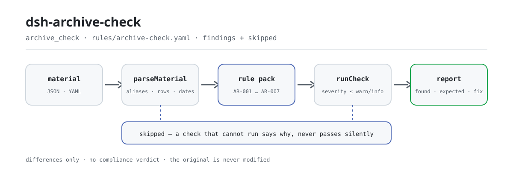

<div align="center">

<picture>
  <source media="(prefers-color-scheme: dark)" srcset="docs/assets/dsh-archive-check-flow-dark.svg">
  
</picture>

# dsh-archive-check

**अभिलेख पंजीकरण रजिस्टर की पंक्ति-दर-पंक्ति जाँच करें — पूर्ण विवरण, अद्वितीय 档号, बिना अंतराल के 件号, आपकी अवधि-सूची के अनुरूप 保管期限 और पठनीय 形成日期 — और पाएँ कि क्या असंगत है, कहाँ, और कैसे ठीक करें।**

DeepSeek Harness के लिए अभिलेख-जाँच प्लगइन, अभिलेखागारिकों और कार्यालय लिपिकों के लिए बना: नियम-पैक विनियमों का शब्दशः उद्धरण देता है, उद्धृत धाराओं के सामने केवल शाब्दिक अंतर बताता है, और न अनुपालन तय करता है, न उत्तरदायित्व, न ही मूल दस्तावेज़ को छूता है।

[इंस्टॉल](#तीन-चरणों-में-शुरुआत) · [कॉन्फ़िगरेशन](#कॉन्फ़िगरेशन) · [FAQ](#faq) · [简体中文](README.md) · [English](README.en.md) · [Español](README.es.md) · [Português](README.pt.md) · [हिन्दी](README.hi.md)

[](LICENSE)
[](#संगतता)
[](https://www.npmjs.com/package/dsh-archive-check)
[](https://github.com/PerryLink/dsh-archive-check/actions/workflows/ci.yml)
[](#संगतता)

[](https://github.com/PerryLink/dsh-archive-check/stargazers)
[](https://www.npmjs.com/package/dsh-archive-check)
[](https://dshfind.com/plugins/PerryLink/dsh-archive-check?ref=badge)
[](https://securityscorecards.dev/viewer/?uri=github.com/PerryLink/dsh-archive-check)
[](https://dsh.market/)
[](https://gitee.com/perrylink/dsh-archive-check)

```sh
dsh plugin --profile <name> add dsh-archive-check
```

</div>

<sub>सामुदायिक प्लगइन, DeepSeek से असंबद्ध। canonical रिपोज़िटरी: <https://github.com/PerryLink/dsh-archive-check> (Gitee एक मिरर है)।</sub>

## यह क्या है

`dsh-archive-check` एक 归档登记表 (फाइलिंग रजिस्टर) पढ़ता है — रजिस्टर में जो कॉलम हैं उनके साथ प्रत्येक प्रविष्टि, तथा वह जिस फंड और वर्ष को समेटता है — और वह जाँचता है जो एक रजिस्टर से यंत्रवत् अपेक्षित किया जा सकता है: क्या प्रत्येक प्रविष्टि में आपके द्वारा कॉन्फ़िगर किए गए विवरण-कॉलम भरे हैं, क्या 档号 रजिस्टर के भीतर अद्वितीय है, क्या 件号 बिना अंतराल के चलता है, क्या 保管期限 आपकी ही अवधि-सूची का कोई शब्द है, क्या 形成日期 पढ़ी जा सकती है और रजिस्टर के वर्ष से मेल खाती है, और क्या आपके कॉन्फ़िगर किए गए हस्तांतरण-काल की अवधि पूरी कर चुकी प्रविष्टियाँ दर्ज होती हैं। आप मूल सामग्री सौंपते हैं (तालिका, रजिस्टर या दस्तावेज़; Excel को पहले JSON/YAML में बदला जा सकता है, प्लेटफ़ॉर्म समर्थन करे तो चैट में भी) और आपको «कौन-सी पंक्ति, कौन-सा कॉलम, क्या कम है» की सूची मिलती है। यह अनुपालन नहीं तय करता, उत्तरदायित्व नहीं ठहराता, समीक्षक की जगह नहीं लेता — और मूल को कभी संशोधित नहीं करता।

## तीन चरणों में शुरुआत

1. **इंस्टॉल करें**:

   ```sh
   dsh plugin --profile <name> add dsh-archive-check
   ```

   वैकल्पिक रूप से, WorkBuddy / Coze में «Professional Document Check Suite» खोजें (पूरा सेट; यह जाँच उसका एक हिस्सा है; उपलब्धता स्टोर के अनुसार)।

2. **न्यूनतम कॉन्फ़िगरेशन** (डिफ़ॉल्ट पर ही काम करता है):

   ```yaml
   - insert:
       - id: dsh-archive-check
         name: dsh-archive-check
   ```

   सभी समायोज्य पैरामीटर `src/config.ts` की Schemastery स्कीमा में हैं और डिफ़ॉल्ट तैयार हैं; प्रति-नियम सीमाएँ `rules/` के नियम-पैक में हैं।

3. **जाँचें कि माउंट हुआ**:

   ```sh
   dsh --profile <name> --dump-config | grep 'dsh-archive-check'
   ```

   फिर bundled सैंपल चलाएँ (लगभग एक मिनट):

   ```sh
   node samples/quickstart/run.mjs --check
   ```

   सैंपल इनपुट `samples/quickstart/input/` में है, अपेक्षित आउटपुट `samples/quickstart/expected/result.json` में, और रन की स्क्रीनशॉट `docs/assets/quickstart.png` में।

**अनइंस्टॉल**: `dsh plugin --profile <name> remove dsh-archive-check` (या profile patch से वह पंक्ति हटाएँ)।

<details>
<summary>DSH Desktop मार्केट से इंस्टॉल करें</summary>

सभी PerryLink प्लगइन DSH Desktop के अंतर्निहित मार्केट में ब्राउज़ किए जा सकते हैं: **Market → Sources → Add source → पेस्ट करें** `https://perrylink-dsh-catalog.perrylink.workers.dev/catalog-source.json` **→ चुनें**। इंस्टॉलेशन के लिए मार्केट की npm पहचान-जाँच और आपकी पुष्टि आवश्यक रहती है।

</details>

## मुख्य क्षमताएँ

यह प्लगइन `archive_check` टूल रजिस्टर करता है: एक रजिस्टर पढ़ता है (प्रविष्टियाँ और उनके कॉलम, साथ में फंड और वर्ष), एक संस्करणित नियम-पैक लागू करता है, और एक संरचित रिपोर्ट लौटाता है।

- **नियम-पैक डेटा है, कोड नहीं** — सभी नियम `rules/archive-check.yaml` में हैं; फ़ाइल बदलते ही नियम-सेट बदल जाता है, TypeScript छूने की ज़रूरत नहीं; पैक लोड के समय सत्यापित होता है, भरोसा नहीं किया जाता।
- **गंभीरता साक्ष्य के अनुसार** — सामान्य सिद्धांत पर आधारित नियम (`derived-from-principle`) की अधिकतम सीमा `warn`; आपकी संस्था के कॉन्फ़िगरेशन पर आधारित (`institutional-configuration`) की सीमा `info`; किसी को भी `error` घोषित नहीं किया जा सकता (एक टेस्ट इसका दावा करता है)।
- **खाली सूची कभी «सब ठीक» नहीं** — जो जाँच न चल सकी वह `skipped` में कारण सहित स्वयं दर्ज करती है, और जिस नियम की अनिवार्य सूची सेट नहीं है वह चुपचाप पास होने के बजाय `skipped` में रिपोर्ट करता है।
- **कोई निर्णय नहीं** — रिपोर्ट केवल अंतर सूचीबद्ध करती है; अनुपालन, उत्तरदायित्व या शुद्धता पर कभी टिप्पणी नहीं; शब्दावली-गार्ड रिपोर्ट में हमेशा अस्वीकरण रखने को बाध्य करता है।
- **उद्धरण केवल शब्दशः** — प्रत्येक नियम में दस्तावेज़, संख्या, स्रोत की अपनी क्रमांकन में धारा, शब्दशः उद्धरण और वह URL होता है जहाँ से पढ़ा गया; आठ अक्षरों से छोटा या न मिल पाया उद्धरण स्वयं उद्धरण में यह कहता है और नियम को `derived-from-principle` चिह्नित करता है — पुनर्कथन को कभी उद्धरण नहीं बताया जाता।

```text
रजिस्टर (फंड · वर्ष · प्रविष्टियाँ) ──archive_check──▶ नियम AR-001…AR-007 ──▶ रिपोर्ट (findings + skipped)
          ▲                                                                                    │
          └────────────────────────────── मूल कभी संशोधित नहीं होता ───────────────────────────┘
```

### नियम एक नज़र में

| नियम | जाँच | गंभीरता | आधार का प्रकार |
|---|---|---|---|
| `AR-001` | प्रत्येक प्रविष्टि में आपके अनिवार्य विवरण-कॉलम भरे हैं (डिफ़ॉल्ट बंद) | info | स्थानीय |
| `AR-002` | 档号 रजिस्टर के भीतर अद्वितीय है | warn | सिद्धांत |
| `AR-003` | 保管期限 आपकी अवधि-सूची का शब्द है (डिफ़ॉल्ट बंद) | info | स्थानीय |
| `AR-004` | 件号 रजिस्टर के भीतर अद्वितीय और बिना अंतराल के हैं | warn | सिद्धांत |
| `AR-005` | 形成日期 पठनीय है और उसका वर्ष रजिस्टर के वर्ष से मेल खाता है | warn | सिद्धांत |
| `AR-006` | रजिस्टर अपना फंड और वर्ष घोषित करता है | warn | सिद्धांत |
| `AR-007` | आपके कॉन्फ़िगर किए हस्तांतरण-काल से आगे की प्रविष्टियाँ (डिफ़ॉल्ट बंद) | info | स्थानीय |

### उदाहरण

ये प्लगइन के वास्तविक प्रवेश-बिंदु हैं; एक बार इंस्टॉल करें, फिर एक को कॉल करें।

**विस्तृत आउटपुट** — टूल `archive_check`, इनपुट:

```json
{"fonds":"某单位","year":2026,"items":[{"档号":"A-2026-001","题名":"","保管期限":"永久", ...}]}
```

आउटपुट:

```json
{
  "id": "dsh-archive-check.AR-001.de09b5a6",
  "ruleId": "AR-001",
  "severity": "info",
  "locator": {
    "row": 1
  },
  "found": "第 1 行缺少 题名",
  "expected": "按本机构配置，归档条目应著录 档号、题名、保管期限",
  "fix": "补齐著录项目；本条只核对字段是否存在，不判断著录内容是否准确"
}
```

*स्रोत `dsh-archive-check/tests/fixtures/AR-001/AR-001-unsafe.json; dsh-archive-check/tests/fixtures/AR-001/cases.json; dsh-archive-check/rules/archive-check.yaml; dsh-archive-check/tests/index.test.ts`*

### यह किन सवालों का जवाब देता है

| आपका सवाल | इसका जवाब |
|---|---|
| मैंने कोई अनिवार्य विवरण-कॉलम कॉन्फ़िगर नहीं किया। क्या विवरण की जाँच चुपचाप पास हो जाती है? | नहीं। जब तक `requiredFields` खाली है, `AR-001` स्वयं को `skipped` में दर्ज करता है, इसलिए खाली अंतर-सूची को «कुछ कम नहीं है» नहीं पढ़ा जाता। अपने कॉलम-नाम भरने के बाद यह केवल यह देखता है कि हर प्रविष्टि में वे कॉलम भरे हैं (खाली स्ट्रिंग अपूर्ण मानी जाती है); विवरण सही है या नहीं, यह नहीं आँकता। |
| दो प्रविष्टियों का 档号 एक ही है, पर एक में बीच में खाली जगह है। क्या यह फिर भी दोहराव है? | हाँ। `AR-002` 档号 की तुलना करते समय खाली जगह नज़रअंदाज़ करता है, इसलिए 「A-2026-001」 और 「A-2026- 001」 एक ही क्रमांक माने जाते हैं। यह `warn` तक सीमित है क्योंकि जिस धारा का यह हवाला देता है वह अद्वितीयता को संकलन-सिद्धांत कहती है, एक ही रजिस्टर में दोहराव पर शब्दशः रोक नहीं; कोई हिट आम तौर पर दोहरा पंजीकरण या गलत 档号 बताता है, जिसकी पुष्टि व्यक्ति को ही करनी होती है। |
| 保管期限 कॉलम में ऐसा कुछ लिखा है जो हमारी अवधि-सूची में नहीं है। जाँच क्या बताती है? | `AR-003` दो स्थितियाँ अलग रखता है: ऐसा मान जिसे पार्सर अवधि-शब्द के रूप में पहचान ही नहीं पाता (पहचाने जाने वाले शब्द हैं 「永久」「长期」「定期N年」「N年」), और ऐसा पहचाना गया शब्द जो आपकी कॉन्फ़िगर की गई `retentionTerms` सूची में नहीं है। सुधार अलग-अलग हैं, इसलिए संदेश भी अलग-अलग हैं। यह नियम कभी तय नहीं करता कि किस दस्तावेज़ के लिए कौन-सी अवधि उचित है, और राष्ट्रीय ढाँचे से लंबी अवधि त्रुटि नहीं है: पैक जिन प्रावधानों का हवाला देता है वे उद्यमों के आँकड़ों को न्यूनतम कहते हैं। |
| 件号 1, 2, 4 हैं — छूटा हुआ 3 दर्ज होता है? | हाँ, पर केवल शुद्ध अंकों वाले 件号 के लिए: `AR-004` क्रम-निरंतरता केवल उन्हीं की जाँच करता है; अक्षर या खाली जगह वाले 件号 तुलना में नहीं आते और कोई अंतर भी दर्ज नहीं होता। अंतराल अपने आप में दोष नहीं — हो सकता है वह क्रमांक इस्तेमाल ही न हुआ हो — इसलिए हिट केवल यह जाँचने को कहता है कि कोई प्रविष्टि पंजीकृत रह गई है या नहीं। `checkSequence: false` पर यह नियम चलता ही नहीं। |
| 形成日期 「二〇二六年三月十五日」 लिखी है। क्या यह पढ़ी जाएगी? | नहीं। `AR-005` इसे «पढ़ा नहीं जा सका» बताता है, जो उस तिथि से अलग संदेश है जिसका वर्ष रजिस्टर के वर्ष से मेल नहीं खाता — दोनों के सुधार अलग-अलग हैं। वर्ष-पार संग्रहण की अनुमति है, और यह नियम तय नहीं करता कि कोई दस्तावेज़ किस वर्ष में रखा जाना चाहिए। |
| जाँच को कैसे पता चलता है कि हस्तांतरण की अवधि आ गई? | `AR-007` प्रत्येक प्रविष्टि की 形成日期 की तुलना आपके कॉन्फ़िगर किए `transferAfterYears` से करता है और केवल यह दर्ज करता है कि निर्धारित वर्षों के अनुसार वह अवधि बीत गई या नहीं। यह पैरामीटर फ़ैक्टरी में `0` है, यानी कॉन्फ़िगर नहीं किया गया, इसलिए जब तक आप इसे सेट न करें यह नियम स्वयं को `skipped` में दर्ज करता है; `requireFormedAt: true` करने पर बिना 形成日期 वाली प्रविष्टियाँ भी अलग से दर्ज होती हैं, क्योंकि बिना तिथि के देय-तिथि निकाली नहीं जा सकती। यह नियम यह नहीं आँकता कि हस्तांतरण आगे बढ़ाया जाए या टाला जाए। |

## कॉन्फ़िगरेशन

सभी समायोज्य पैरामीटर `src/config.ts` की Schemastery स्कीमा में हैं, इसलिए कोड बदले बिना `cordis.yml` से बदले जा सकते हैं; प्रति-नियम सीमाएँ `rules/` के नियम-पैक में हैं। तालिका की पाँच कुंजियाँ ही पूरी सूची हैं; नियम-स्तरीय पैरामीटर आगे हैं।

| कुंजी | प्रकार | डिफ़ॉल्ट | विवरण |
|---|---|---|---|
| `rulesFile` | string | `rules/archive-check.yaml` | नियम-पैक का पथ, पैकेज रूट के सापेक्ष |
| `disabledRules` | string[] | `[]` | बंद करने वाले नियम id; प्रत्येक `skipped` में दिखता है |
| `onlyRules` | string[] | `[]` | केवल ये नियम चलाएँ; खाली होने पर सभी नियम चलते हैं |
| `skipNotes` | string | `""` | हर `skipped` कारण के आगे जोड़ी जाने वाली टिप्पणी |
| `timeoutMs` | number | `120000` | उपकरण का सहकारी समय-सीमा बजट |

जानने योग्य नियम-स्तरीय पैरामीटर:

- `AR-001` `requiredFields` — वे कॉलम जो हर पंक्ति को भरनी है, जैसे `[档号, 题名, 保管期限, 责任者]`। खाली का अर्थ है नियम नहीं चलता। खाली सेल अपूर्ण मानी जाती है।
- `AR-003` `retentionTerms` — आपकी अवधि-सूची के शब्द, जैसे `[永久, 定期30年, 定期10年]`; एक-बार की तुलना के लिए कॉल पर भी दिया जा सकता है।
- `AR-004` `checkSequence` — 件号 निरंतरता जाँच बंद करने के लिए `false` रखें।
- `AR-006` `requireHeader` — यदि आपका रजिस्टर वैध रूप से फंड या वर्ष नहीं रखता तो `false` रखें।
- `AR-007` `transferAfterYears` — **आपके** अभिलेखागार की हस्तांतरण-अवधि: केंद्रीय / प्रादेशिक / उप-प्रादेशिक ग्राही अभिलेखागार के लिए `20`, ज़िला-स्तरीय के लिए `10` (उद्धृत कार्यान्वयन विनियम के अनुसार)। `0` का अर्थ है नियम नहीं चलता। `AR-007` `requireFormedAt` होने पर 形成日期 कॉलम की अनुपस्थिति छूट के बजाय निष्कर्ष बनती है, क्योंकि बिना तिथि के देय-तिथि नहीं निकल सकती।

## FAQ

<details>
<summary>क्या मेरी सामग्री में बदलाव होता है या कहीं अपलोड होती है?</summary>

नहीं। टूल केवल आपके द्वारा दिया गया JSON/YAML पाठ पढ़ता है और **मूल को कभी संशोधित नहीं करता**; प्लगइन शुद्ध ESM है, कोई नेटिव कोड नहीं, **कोई नेटवर्क नहीं, कोई मॉडल कॉल नहीं** (संगतता देखें), इसलिए सामग्री आपकी मशीन से बाहर नहीं जाती।

</details>

<details>
<summary>बिना अनिवार्य कॉलम या अवधि-सूची कॉन्फ़िगर किए, क्या कुछ चुपचाप पास होता है?</summary>

नहीं। दोनों सूचियाँ — `AR-001` की `requiredFields` और `AR-003` की `retentionTerms` — फ़ैक्टरी में खाली आती हैं, और जिस नियम की सूची सेट नहीं है वह कारण सहित `skipped` में दर्ज होता है, इसलिए खाली अंतर-सूची कभी «कुछ कम नहीं है» नहीं पढ़ी जाती। `AR-003` को नियम-पैक बदले बिना एक-बार की तुलना के लिए कॉल पर भी दिया जा सकता है।

</details>

<details>
<summary>प्लगइन इंस्टॉल हो गया पर टूल दिखता ही नहीं — अब क्या?</summary>

जाँचें कि `main` `lib/index.mjs` पर जाता है और `pnpm run build` ने उसे बनाया है; गलत `main` लोडर को उस प्रविष्टि को चुपचाप छोड़ने पर मजबूर करता है।

</details>

<details>
<summary>इंस्टॉल संस्करण-असंगत बताकर रद्द हो गया — अब क्या?</summary>

peer रेंज `0.1.x` और `0.2.x` दोनों लाइनें कवर करती है; यदि आपका रनटाइम इससे बाहर है तो स्पष्ट छूट दें: `dsh plugin --profile <name> allow-version dsh-archive-check@0.1.0 --dsh-version <runtime> --accept-risk`। peer अनुकूलता इंस्टॉल के समय रनटाइम द्वारा लागू होती है।

</details>

<details>
<summary>क्या यह पूरे साल के रजिस्टर या पूरा डायरेक्टरी एक साथ संभाल सकता है?</summary>

टूल `native` और `ptc` दोनों मोड में काम करता है; एक साल के रजिस्टरों के लिए `ptc` चुनें, ताकि स्कीमा लागत सिर्फ एक बार चुकानी पड़े। सारी गणना दिए गए स्ट्रिंग पर वॉल-क्लॉक है, समय-क्षेत्र रूपांतरण के बिना।

</details>

## यह किन मानकों पर आधारित है

| दस्तावेज़ | संख्यांक | इन्हें उद्धृत करने वाले नियम |
|---|---|---|
| 《归档文件整理规则》 | DA/T 22—2015 | AR-001, AR-002, AR-004, AR-005, AR-006 |
| 《中华人民共和国档案法实施条例》 | 国务院令第772号 | AR-001, AR-003, AR-007 |
| 《机关文件材料归档范围和文书档案保管期限规定》 | 国家档案局令第8号 | AR-003 |
| 《企业文件材料归档范围和档案保管期限规定》 | 国家档案局令第10号 | AR-003 |
| 《中华人民共和国档案法》 | 2020年修订（主席令第四十七号） | AR-007 |

**सीमा:** यह प्लगइन एक **归档登记表** (फाइलिंग रजिस्टर) की जाँच उन्हीं बातों पर करता है जिन्हें एक रजिस्टर से यंत्रवत् अपेक्षित किया जा सकता है — कि प्रत्येक प्रविष्टि इतनी पूरी तरह वर्णित है कि उसे संग्रहीत कर फिर खोजा जा सके, 档号 अद्वितीय है, 件号 बिना अंतराल के चलता है, अवधि-शब्द आपकी सूची से आते हैं, और 形成日期 पठनीय है तथा रजिस्टर के वर्ष से मेल खाती है। यह **नहीं** तय करता कि कोई दस्तावेज़ संग्रह में आना चाहिए था या नहीं, न ही कि उसके लिए कौन-सी अवधि उचित है। ये अभिलेखागारिक के निर्णय हैं।

> ### ⚠️ तीन काम जो यह प्लगइन करने से इनकार करता है, और क्यों
>
> **1. यह कभी तय नहीं करता कि किसी दस्तावेज़ के लिए कौन-सी अवधि उचित है।** कोई **एकल राष्ट्रीय
> अवधि-तालिका** मौजूद नहीं जिसे आप सीधे लागू कर सकें। कार्यान्वयन विनियम (अनुच्छेद 19, दूसरा पैरा)
> और आदेश सं. 8 (अनुच्छेद 12) हर संस्था से अपना संग्रह-दायरा और अवधि-सूची स्वयं बनाकर अभिलेख
> प्राधिकरण से अनुमोदित कराने को कहते हैं; और आदेश सं. 10 (अनुच्छेद 11) कहता है कि उद्यमों के आँकड़े
> **न्यूनतम** हैं — उद्यम कानूनी रूप से *लंबी* अवधि चुन सकता है। इसलिए `AR-003` केवल यह जाँचता है कि
> शब्दावली वही है जो आपने कॉन्फ़िगर की है, और एक टेस्ट दावा करता है कि पैक लंबी अवधि को «त्रुटि नहीं» कहता।
>
> **2. यह हस्तांतरण-वर्षों को उनके सही स्थान पर रखता है।** 20 / 10 वर्ष के आँकड़े कार्यान्वयन विनियम
> (अनुच्छेद 20, दूसरा पैरा) में हैं, और *ग्राही अभिलेखागार के स्तर* से बँधे हैं, न कि इससे कि इकाई
> उद्यम है या नहीं। अभिलेख कानून के अनुच्छेद 15 में **कोई वर्ष-आँकड़ा नहीं** है — वह केवल «संबंधित
> राज्य-विनियमों के अनुसार, नियमित रूप से» कहता है। «20 वर्ष» को अनुच्छेद 15 से जोड़ना गढ़ंत होगा,
> और एक टेस्ट दावा करता है कि पैक ऐसा नहीं करता।
>
> **3. यह अप्रचलित पहले अनुच्छेद का उपयोग नहीं करता।** आदेश सं. 8 का अनुच्छेद 1 वर्ष 1999 के
> कार्यान्वयन उपायों का हवाला देता है, जिन्हें वर्ष 2024 का विनियम (राज्यपरिषद आदेश सं. 772) ने अपने
> अनुच्छेद 52 में निरस्त कर दिया। पैक इसका कभी हवाला नहीं देता, और एक टेस्ट इसका दावा करता है।
>
> दो सूचियाँ आपकी हैं, कानून की नहीं: अनिवार्य विवरण-कॉलम (`AR-001`) और आपकी अवधि-शब्दावली
> (`AR-003`)। दोनों फ़ैक्टरी में **खाली** आती हैं, और जिस नियम की सूची सेट नहीं है वह चुपचाप पास होने
> के बजाय `skipped` में दर्ज करता है।

## सामग्री प्रारूप

टूल JSON या YAML स्वीकार करता है:

```yaml
fonds: 某单位
year: 2026
items:
  - { 档号: A-2026-001, 题名: 关于第一项工作的通知, 保管期限: 永久,   形成日期: 2026-03-15, 件号: "1" }
  - { 档号: A-2026-002, 题名: 关于第二项工作的通知, 保管期限: 定期30年, 形成日期: 2026-04-01, 件号: "2" }
```

कॉलम-नाम `档号`/`档案号`, `题名`/`文件题名`/`标题`, `保管期限`/`期限`, `形成日期`/`成文日期`/`日期` और `件号`/`序号` में से पहचाने जाते हैं। शीर्षकों की साधारण सूची भी चलती है — हर स्ट्रिंग किसी प्रविष्टि का 题名 बन जाती है। संख्याएँ स्ट्रिंग के रूप में स्वीकार्य हैं, इसलिए स्प्रेडशीट निर्यात को साफ करने की ज़रूरत नहीं।

`保管期限` दो रूपों में पढ़ा जाता है: स्थायी के लिए `永久`/`长期`, और निश्चित अवधि के लिए कोई भी `N年`/`定期N年`/अकेला `N`। जो शब्द पढ़ा न जा सके वह «अपठनीय» रिपोर्ट होता है, जो आपकी कॉन्फ़िगर सूची से बाहर के शब्द से अलग है — दोनों अलग निष्कर्ष देते हैं, क्योंकि दोनों के सुधार अलग हैं।

## नियमों के स्रोत

नियम-डेटा `rules/archive-check.yaml` में रहता है, कोड से अलग। प्रत्येक नियम में दस्तावेज़, संख्या, स्रोत की अपनी क्रमांकन-प्रणाली के अनुसार धारा, शब्दशः उद्धरण और स्रोत URL होता है। लोडर लागू करता है कि उद्धरण कम से कम आठ अक्षरों का वास्तविक उद्धरण हो, और जिस जाँच का आधार केवल सामान्य सिद्धांत या स्थानीय नीति हो, उसे कभी `error` घोषित न किया जाए।

उद्धृत धाराएँ इनसे आती हैं:

- **《中华人民共和国档案法》** (2020-06-20 संशोधन, 主席令第四十七号, 2021-01-01 से प्रभावी) — अनुच्छेद 13–15, 21, 37, 39
- **《中华人民共和国档案法实施条例》** (**国务院令第772号**, 2024-01-12 प्रकाशित, **2024-03-01 से प्रभावी**; इसका अनुच्छेद 52 वर्ष 1999 के कार्यान्वयन उपायों को निरस्त करता है) — अनुच्छेद 19, 20, 24, 39, 40
- **《机关文件材料归档范围和文书档案保管期限规定》** (国家档案局令第8号) — अनुच्छेद 3, 4, 6, 12, 14
- **《企业文件材料归档范围和档案保管期限规定》** (国家档案局令第10号) — अनुच्छेद 7, 11, 15, 16
- **《归档文件整理规则》** (DA/T 22—2015) — 5.2.2, 5.3.1, 5.4.1, 5.4.3 e), 5.5.2

तीन सुधारों ने इस पैक को आकार दिया और उसके शीर्षक में दर्ज हैं:

1. **विनियम बदल गया।** राज्यपरिषद आदेश सं. 772 2024-03-01 से प्रभावी है और 1999 के उपायों को निरस्त करता है, इसलिए आदेश सं. 8 के अनुच्छेद 1 (जो निरस्त पाठ का हवाला देता है) का कभी उद्धरण नहीं दिया जाता।
2. **हस्तांतरण-वर्ष विनियम में हैं, कानून में नहीं।** अनुच्छेद 20, दूसरा पैरा 20/10 वर्ष के आँकड़े रखता है और उन्हें ग्राही अभिलेखागार के स्तर से बाँधता है; अभिलेख कानून के अनुच्छेद 15 में कोई वर्ष नहीं है।
3. **कोई सार्वभौमिक अवधि-तालिका नहीं है।** हर संस्था अपनी सूची स्वयं बनाकर अनुमोदित कराती है, और उद्यमों के आँकड़े वैध न्यूनतम हैं, अधिकतम नहीं।

धारा-सत्यापन की पूरी रिपोर्ट, जाँची और खारिज की गई स्रोतों सहित, `rules/evidence/clause-verification.md` में है।

## संगतता

| सतह | स्थिति |
|---|---|
| Harness | peer रेंज `>=0.1.2-rc.1 <0.2.0 \|\| >=0.2.0-0 <0.3.0` — `0.2.0-rc.2` और `0.2.1-rc.2` दोनों को स्वीकार करने के लिए सत्यापित। `engines.dsh` `>=0.2.1-0 <0.3.0` के रूप में घोषित है और 0.2.1 से होस्ट इसे लागू करता है |
| Node | `^22.19.0 \|\| >=24.0.0` |
| प्लेटफ़ॉर्म | सभी (शुद्ध ESM; कोई नेटिव कोड नहीं, कोई नेटवर्क नहीं, कोई मॉडल कॉल नहीं) |
| टूल मोड | `native` और `ptc` में काम करता है; एक साल के रजिस्टरों के लिए `ptc` चुनें |

## समस्या निवारण

- **`AR-001` और `AR-003` स्वयं को `skipped` में दर्ज करते हैं।** उनकी सूचियाँ खाली हैं। `AR-003` को कॉल पर भी दिया जा सकता है, इसलिए एक-बार की तुलना के लिए नियम-पैक बदलना ज़रूरी नहीं।
- **`AR-004` कुछ नहीं बताता।** शुद्ध पूर्णांक के रूप में पढ़े गए 件号 दो से कम हैं — अल्फ़ान्यूमेरिक संदर्भ जानबूझकर निरंतरता जाँच से बाहर रखे जाते हैं, अनुमान लगाए नहीं जाते।
- **`AR-005` मेरी पठनीय तिथि पर चिंता करता है।** रीडर `2026-03-15` और `2026-03-15 09:30` स्वीकार करता है; चीनी अंकों में लिखी तिथि जानबूझकर अपठनीय रिपोर्ट होती है, ताकि आप तय करें कि निर्यात सामान्यीकृत करना है या नहीं।
- **रीडर पहले स्वीकार किया रजिस्टर मना कर देता है।** उसे कोई ज्ञात अभिलेख कॉलम नहीं मिला; त्रुटि उन कॉलमों के नाम बताती है जो उसने देखे।
- **प्लगइन इंस्टॉल हो गया पर टूल दिखता नहीं।** जाँचें कि `main` `lib/index.mjs` पर जाता है और `pnpm run build` ने उसे बनाया है; गलत `main` लोडर को उस प्रविष्टि को चुपचाप छोड़ने पर मजबूर करता है।
- **`dsh plugin add` असंगत बताकर मना करता है।** peer रेंज `0.1.x` और `0.2.x` कवर करती है; बाहर होने पर स्पष्ट छूट दें: `dsh plugin --profile <name> allow-version dsh-archive-check@0.1.0 --dsh-version <runtime> --accept-risk`
- **`check` में `manifest-peers` विफल दिखता है।** स्टैटिक चेकर 0.2 लाइन से पहले की हार्ड-कोडेड peer रेंज से तुलना करता है। रनटाइम इंस्टॉल के समय अनुकूलता लागू करता है, इसलिए घोषित रेंज ही सही है; यह `dsh-plugin-dev` की ज्ञात अपस्ट्रीम समस्या है।
- **समय खिसका हुआ लगता है।** सारी गणना दिए गए स्ट्रिंग पर वॉल-क्लॉक है, समय-क्षेत्र रूपांतरण के बिना।

## इकोसिस्टम और गुणवत्ता

- [Gitee मिरर](https://gitee.com/perrylink/dsh-archive-check) (समन्वित मिरर; GitHub canonical है)
- [dshfind प्लगइन पेज](https://dshfind.com/plugins/PerryLink/dsh-archive-check) (इंस्टॉल और रैंकिंग)
- [OpenSSF Scorecard रिपोर्ट](https://securityscorecards.dev/viewer/?uri=github.com/PerryLink/dsh-archive-check) ([.github/workflows/scorecard.yml](.github/workflows/scorecard.yml) द्वारा संचालित)
- [DSH Market](https://dsh.market/) (सूचीबद्ध)
- [इकोसिस्टम नॉलेज बेस — सामग्री के अनुसार चेकर चुनें](https://perrylink.github.io/zh/checkers/choose/) (पूरा पारिवारिक सूचीपत्र: 62 चेकर + सामान्य प्लगइन)

## डेवलपमेंट

```sh
pnpm install
pnpm run typecheck   # tsc --noEmit
pnpm test            # vitest, प्रति-नियम युग्मित fixtures (tests/fixtures/<RULE>/)
pnpm run build       # tsdown -> lib/index.mjs + lib/index.d.mts
pnpm run check:readmes   # पाँच-भाषा README संगति
node ../scripts/sync-shared.mjs dsh-archive-check   # ../_shared से src/shared ताज़ा करें
```

नियम-पैक डेटा है, कोड नहीं: नियम-सेट बदलने के लिए `rules/*.yaml` संपादित करें, TypeScript छूए बिना; पैक लोड के समय सत्यापित होता है, भरोसा नहीं किया जाता। README चित्र [`scripts/gen-readme-assets.py`](scripts/gen-readme-assets.py) (Python + Pillow) से प्रोग्रामेटिक रूप से बनते हैं और सुरक्षित रूप से फिर चलाए जा सकते हैं; इस प्लगइन में UI नहीं है, इसलिए hero हाथ-लिखा SVG प्रवाह-आरेख है (हल्का/गहरा जोड़ा, केवल कमांड-सतह token)।

Topics: `dsh`, `dsh-plugin`, `deepseek-harness`, `cordis`, `archive`

## परिवार और आभार

यह प्रोजेक्ट [PerryLink](https://github.com/PerryLink) द्वारा रखरखाव किए गए DeepSeek Harness प्लगइन परिवार का हिस्सा है (सभी Apache-2.0)। अगर यह प्लगइन काम आए तो **एक स्टार** कुछ अनलॉक नहीं करता, पर अगले व्यक्ति को इसे खोजने में मदद करता है।

- [@PerryLink](https://github.com/PerryLink) — निर्माता और रखरखावकर्ता: `archive_check` टूल, शब्दशः उद्धरण वाला नियम-पैक और उसका धारा-सत्यापन रिकॉर्ड, तथा पाँच-भाषा प्रलेखन।

<details>
<summary>सभी प्लगइन खोलें</summary>

| प्लगइन | स्थिति |
|---|---|
| **[dsh-aqua-input-check](https://github.com/PerryLink/dsh-aqua-input-check)** |  |
| **[dsh-archive-check](https://github.com/PerryLink/dsh-archive-check)** |  |
| **[dsh-auto-review](https://github.com/PerryLink/dsh-auto-review)** |  |
| **[dsh-autotier](https://github.com/PerryLink/dsh-autotier)** | 🧊 फ़्रोज़न — रेपो README देखें |
| **[dsh-bid-ca-precheck](https://github.com/PerryLink/dsh-bid-ca-precheck)** |  |
| **[dsh-bid-qual-check](https://github.com/PerryLink/dsh-bid-qual-check)** |  |
| **[dsh-cert-mcp](https://github.com/PerryLink/dsh-cert-mcp)** | 🧊 फ़्रोज़न — रेपो README देखें |
| **[dsh-checkpoint-rewind](https://github.com/PerryLink/dsh-checkpoint-rewind)** |  |
| **[dsh-click](https://github.com/PerryLink/dsh-click)** |  |
| **[dsh-composer-history](https://github.com/PerryLink/dsh-composer-history)** |  |
| **[dsh-contract-stance](https://github.com/PerryLink/dsh-contract-stance)** |  |
| **[dsh-customs-doc-check](https://github.com/PerryLink/dsh-customs-doc-check)** |  |
| **[dsh-data-quality](https://github.com/PerryLink/dsh-data-quality)** | 🧊 फ़्रोज़न — रेपो README देखें |
| **[dsh-demurrage-ledger](https://github.com/PerryLink/dsh-demurrage-ledger)** |  |
| **[dsh-doublecheck](https://github.com/PerryLink/dsh-doublecheck)** |  |
| **[dsh-drill-script-check](https://github.com/PerryLink/dsh-drill-script-check)** |  |
| **[dsh-eia-guide-check](https://github.com/PerryLink/dsh-eia-guide-check)** |  |
| **[dsh-emergency-plan](https://github.com/PerryLink/dsh-emergency-plan)** |  |
| **[dsh-essay-rubric-check](https://github.com/PerryLink/dsh-essay-rubric-check)** |  |
| **[dsh-evidence-check](https://github.com/PerryLink/dsh-evidence-check)** |  |
| **[dsh-export-ctl-check](https://github.com/PerryLink/dsh-export-ctl-check)** |  |
| **[dsh-fast](https://github.com/PerryLink/dsh-fast)** |  |
| **[dsh-fmea-table-check](https://github.com/PerryLink/dsh-fmea-table-check)** |  |
| **[dsh-forecast-penalty](https://github.com/PerryLink/dsh-forecast-penalty)** |  |
| **[dsh-fund-research](https://github.com/PerryLink/dsh-fund-research)** |  |
| **[dsh-github](https://github.com/PerryLink/dsh-github)** |  |
| **[dsh-gongwen-flow-check](https://github.com/PerryLink/dsh-gongwen-flow-check)** |  |
| **[dsh-gongwen-word-check](https://github.com/PerryLink/dsh-gongwen-word-check)** |  |
| **[dsh-guard-plan-qc](https://github.com/PerryLink/dsh-guard-plan-qc)** |  |
| **[dsh-hazchem-check](https://github.com/PerryLink/dsh-hazchem-check)** |  |
| **[dsh-hazplan-check](https://github.com/PerryLink/dsh-hazplan-check)** |  |
| **[dsh-hidden-risk-map](https://github.com/PerryLink/dsh-hidden-risk-map)** |  |
| **[dsh-hs-classify](https://github.com/PerryLink/dsh-hs-classify)** |  |
| **[dsh-icd-rule-check](https://github.com/PerryLink/dsh-icd-rule-check)** |  |
| **[dsh-industry-research](https://github.com/PerryLink/dsh-industry-research)** |  |
| **[dsh-lawcite-adapter](https://github.com/PerryLink/dsh-lawcite-adapter)** |  |
| **[dsh-laya](https://github.com/PerryLink/dsh-laya)** |  |
| **[dsh-lc-doc-check](https://github.com/PerryLink/dsh-lc-doc-check)** |  |
| **[dsh-learning-gap-check](https://github.com/PerryLink/dsh-learning-gap-check)** |  |
| **[dsh-library](https://github.com/PerryLink/dsh-library)** |  |
| **[dsh-local-ai](https://github.com/PerryLink/dsh-local-ai)** |  |
| **[dsh-lsp-actions](https://github.com/PerryLink/dsh-lsp-actions)** |  |
| **[dsh-mask](https://github.com/PerryLink/dsh-mask)** |  |
| **[dsh-mcp-panel](https://github.com/PerryLink/dsh-mcp-panel)** |  |
| **[dsh-medrec-qc](https://github.com/PerryLink/dsh-medrec-qc)** |  |
| **[dsh-memento](https://github.com/PerryLink/dsh-memento)** | 🧊 फ़्रोज़न — रेपो README देखें |
| **[dsh-nsfc-form-check](https://github.com/PerryLink/dsh-nsfc-form-check)** |  |
| **[dsh-nurse-record-check](https://github.com/PerryLink/dsh-nurse-record-check)** |  |
| **[dsh-observe](https://github.com/PerryLink/dsh-observe)** |  |
| **[dsh-origin-rvc-check](https://github.com/PerryLink/dsh-origin-rvc-check)** |  |
| **[dsh-ota-review-check](https://github.com/PerryLink/dsh-ota-review-check)** |  |
| **[dsh-output-styles](https://github.com/PerryLink/dsh-output-styles)** |  |
| **[dsh-paper-doc-adapter](https://github.com/PerryLink/dsh-paper-doc-adapter)** |  |
| **[dsh-permission-rules](https://github.com/PerryLink/dsh-permission-rules)** |  |
| **[dsh-permit-report-check](https://github.com/PerryLink/dsh-permit-report-check)** |  |
| **[dsh-pipeline-check](https://github.com/PerryLink/dsh-pipeline-check)** |  |
| **[dsh-pleading-draft](https://github.com/PerryLink/dsh-pleading-draft)** |  |
| **[dsh-plugin-doctor](https://github.com/PerryLink/dsh-plugin-doctor)** | 🚫 रिटायर्ड (रेपो संग्रहीत) |
| **[dsh-plugin-guide](https://github.com/PerryLink/dsh-plugin-guide)** |  |
| **[dsh-plugin-kit](https://github.com/PerryLink/dsh-plugin-kit)** | 🚫 रिटायर्ड (रेपो संग्रहीत) |
| **[dsh-plugin-upgrade](https://github.com/PerryLink/dsh-plugin-upgrade)** | 🚫 रिटायर्ड (रेपो संग्रहीत) |
| **[dsh-policy-brief-draft](https://github.com/PerryLink/dsh-policy-brief-draft)** |  |
| **[dsh-power-loss-split](https://github.com/PerryLink/dsh-power-loss-split)** |  |
| **[dsh-power-ticket-check](https://github.com/PerryLink/dsh-power-ticket-check)** |  |
| **[dsh-ppap-check](https://github.com/PerryLink/dsh-ppap-check)** |  |
| **[dsh-protest-deadline](https://github.com/PerryLink/dsh-protest-deadline)** |  |
| **[dsh-railway-window](https://github.com/PerryLink/dsh-railway-window)** |  |
| **[dsh-repair-order-qc](https://github.com/PerryLink/dsh-repair-order-qc)** |  |
| **[dsh-research-report](https://github.com/PerryLink/dsh-research-report)** |  |
| **[dsh-review-reply-check](https://github.com/PerryLink/dsh-review-reply-check)** |  |
| **[dsh-rulefile-check](https://github.com/PerryLink/dsh-rulefile-check)** |  |
| **[dsh-safety-brief-check](https://github.com/PerryLink/dsh-safety-brief-check)** |  |
| **[dsh-score](https://github.com/PerryLink/dsh-score)** | 🧊 फ़्रोज़न — रेपो README देखें |
| **[dsh-session-sync](https://github.com/PerryLink/dsh-session-sync)** |  |
| **[dsh-site-log-check](https://github.com/PerryLink/dsh-site-log-check)** |  |
| **[dsh-skill-pack-security](https://github.com/PerryLink/dsh-skill-pack-security)** |  |
| **[dsh-soe-decision-check](https://github.com/PerryLink/dsh-soe-decision-check)** |  |
| **[dsh-soilwater-check](https://github.com/PerryLink/dsh-soilwater-check)** |  |
| **[dsh-sop-sync-check](https://github.com/PerryLink/dsh-sop-sync-check)** |  |
| **[dsh-spc-gbt-adapter](https://github.com/PerryLink/dsh-spc-gbt-adapter)** |  |
| **[dsh-talk](https://github.com/PerryLink/dsh-talk)** |  |
| **[dsh-tender-extract](https://github.com/PerryLink/dsh-tender-extract)** |  |
| **[dsh-tender-matrix](https://github.com/PerryLink/dsh-tender-matrix)** |  |
| **[dsh-test-drive](https://github.com/PerryLink/dsh-test-drive)** |  |
| **[dsh-ticktick](https://github.com/PerryLink/dsh-ticktick)** | 🚫 रिटायर्ड (रेपो संग्रहीत) |
| **[dsh-translate](https://github.com/PerryLink/dsh-translate)** |  |
| **[dsh-warranty-calc](https://github.com/PerryLink/dsh-warranty-calc)** |  |
| **[dsh-budget](https://github.com/PerryLink/dsh-budget)** | 🧊 फ़्रोज़न — रेपो README देखें |
| **[dsh-claude-move](https://github.com/PerryLink/dsh-claude-move)** | 🧊 फ़्रोज़न — रेपो README देखें |
| **[dsh-defend](https://github.com/PerryLink/dsh-defend)** | 🧊 फ़्रोज़न — रेपो README देखें |
| **[dsh-draw](https://github.com/PerryLink/dsh-draw)** | 🧊 फ़्रोज़न — रेपो README देखें |
| **[dsh-reach](https://github.com/PerryLink/dsh-reach)** | 🧊 फ़्रोज़न — रेपो README देखें |
| **[dsh-background-agents](https://github.com/PerryLink/dsh-background-agents)** | 🚫 रिटायर्ड (रेपो संग्रहीत) |
| **[dsh-session-pin](https://github.com/PerryLink/dsh-session-pin)** | 🚫 रिटायर्ड (रेपो संग्रहीत) |
| **[dsh-team-rooms](https://github.com/PerryLink/dsh-team-rooms)** | 🚫 रिटायर्ड (रेपो संग्रहीत) |

</details>

## लाइसेंस

[LICENSE](LICENSE) (Apache License 2.0) © 2026 dsh-archive-check contributors

<p align="center"><sub>Apache-2.0 · सामुदायिक प्लगइन, DeepSeek से असंबद्ध।</sub></p>
