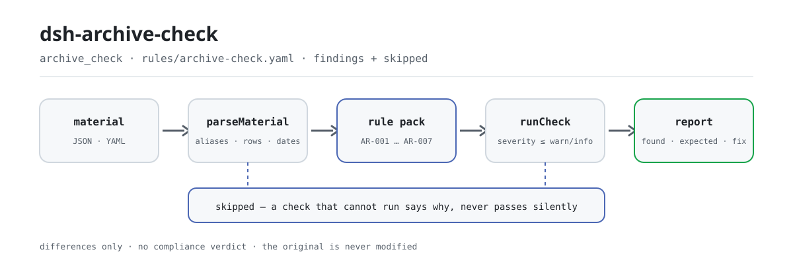

<div align="center">

<picture>
  <source media="(prefers-color-scheme: dark)" srcset="docs/assets/dsh-archive-check-flow-dark.svg">
  
</picture>

# dsh-archive-check

**逐行核对归档登记表的著录完整性、档号唯一性、件号连续性、保管期限用词与形成日期——输出「哪一行、哪一栏、差什么」的清单。**

面向档案员与办公室文秘的 DeepSeek Harness 检查插件：规则包逐条引用法规原文，只列材料与条款之间的字面差异，不下合规结论、不认定责任、不改原件。

[安装](#三步上手) · [配置](#配置) · [FAQ](#faq) · [简体中文](README.md) · [English](README.en.md) · [Español](README.es.md) · [Português](README.pt.md) · [हिन्दी](README.hi.md)

[](LICENSE)
[](#兼容性)
[](https://www.npmjs.com/package/dsh-archive-check)
[](https://github.com/PerryLink/dsh-archive-check/actions/workflows/ci.yml)
[](#兼容性)

[](https://github.com/PerryLink/dsh-archive-check/stargazers)
[](https://www.npmjs.com/package/dsh-archive-check)
[](https://dshfind.com/plugins/PerryLink/dsh-archive-check?ref=badge)
[](https://securityscorecards.dev/viewer/?uri=github.com/PerryLink/dsh-archive-check)
[](https://dsh.market/)
[](https://gitee.com/perrylink/dsh-archive-check)

```sh
dsh plugin --profile <name> add dsh-archive-check
```

</div>

<sub>社区插件，与 DeepSeek 官方无关。唯一仓库：<https://github.com/PerryLink/dsh-archive-check>（Gitee 为镜像）。</sub>

## 它是什么

`dsh-archive-check` 读取一份归档登记表——登记表自带的栏目逐条列出，加上它所覆盖的全宗与年度——核对登记表自身可以机械判定的事项：每条是否填写了本机构配置的著录栏目、档号在同一登记范围内是否唯一、件号是否连续无缺号、保管期限是否使用本机构期限表的用词、形成日期是否可解析并与登记年度一致，以及是否报出已过本机构配置移交期限的条目。你交出原始材料（表格、清单或文书；Excel 可先转成 JSON/YAML，对话里也能代转），它返回一份「哪一行、哪一栏、差什么」的差异清单。它不下合规结论、不认定责任、不替代审核人，也绝不修改原件。

## 三步上手

1. **安装**：

   ```sh
   dsh plugin --profile <name> add dsh-archive-check
   ```

   也可以在 WorkBuddy / 扣子搜「职业文档核对全集」（总包，本检查是其中一项；上架以商城为准）。

2. **最小配置**（默认即可用）：

   ```yaml
   - insert:
       - id: dsh-archive-check
         name: dsh-archive-check
   ```

   全部可调项都在 `src/config.ts` 的 Schemastery schema 里，默认值开箱即用；逐条阈值在 `rules/` 下的规则包里。

3. **验证已生效**：

   ```sh
   dsh --profile <name> --dump-config | grep 'dsh-archive-check'
   ```

   再用自带样例跑一次（约 1 分钟）：

   ```sh
   node samples/quickstart/run.mjs --check
   ```

   样例输入在 `samples/quickstart/input/`，期望输出在 `samples/quickstart/expected/result.json`，运行截图见 `docs/assets/quickstart.png`。

**卸载**：`dsh plugin --profile <name> remove dsh-archive-check`（或从 profile patch 删掉该行）。

<details>
<summary>从 DSH Desktop 市场安装</summary>

所有 PerryLink 插件均可在 DSH Desktop 内置市场中浏览：**市场 → 来源 → 添加来源 → 粘贴** `https://perrylink-dsh-catalog.perrylink.workers.dev/catalog-source.json` **→ 选中**。安装仍需通过市场的 npm 身份校验与你的确认。

</details>

## 核心能力

本插件注册 `archive_check` 工具：读入一份登记表（各条目及其栏目，加上全宗与年度），套用带版本的规则包，返回一份结构化报告。

- **规则包即数据** —— 检查规则全部在 `rules/archive-check.yaml` 里，换规则不动代码；规则包在加载期校验，而非被信任。
- **严重级跟着依据走** —— 依据为原则性条款（`derived-from-principle`）的规则封顶 `warn`；依据为本机构配置（`institutional-configuration`）的阈值封顶 `info`；绝不会把原则或本地配置标成 `error`（有测试断言）。
- **空清单不等于没问题** —— 每一项无法执行的检查都会在 `skipped` 里自报原因；必填清单未配置的规则自报 `skipped`，而不是静默通过。
- **不裁决** —— 报告只列差异，永不判定合规、责任或对错；措辞守卫强制报告始终携带免责声明。
- **引文必须逐字** —— 每条规则带文件名、文号、条款号、逐字摘录与来源链接；摘录不足八个字符或无法取得原文时，在摘录里明说并把规则标记为 `derived-from-principle`，绝不把转述包装成引文。

```text
登记表（全宗 · 年度 · 条目）──archive_check──▶ 规则包 AR-001…AR-007 ──▶ 报告（findings + skipped）
        ▲                                                                          │
        └──────────────────────────── 原件永不修改 ────────────────────────────────┘
```

### 规则一览

| 规则 | 核对内容 | 严重级 | 依据类型 |
|---|---|---|---|
| `AR-001` | 每条是否填写本机构配置的必填著录栏目（默认关闭） | info | 本机构配置 |
| `AR-002` | 档号在同一登记范围内唯一 | warn | 原则性条款 |
| `AR-003` | 保管期限使用本机构期限表的用词（默认关闭） | info | 本机构配置 |
| `AR-004` | 件号在同一登记范围内唯一且连续无缺号 | warn | 原则性条款 |
| `AR-005` | 形成日期可解析，且年度与登记年度一致 | warn | 原则性条款 |
| `AR-006` | 登记表声明其全宗与年度 | warn | 原则性条款 |
| `AR-007` | 是否已过本机构配置的移交期限（默认关闭） | info | 本机构配置 |

### 示例

以下为插件真实入口；安装后调用一次即可。

**详细输出** — 工具 `archive_check`，输入：

```json
{"fonds":"某单位","year":2026,"items":[{"档号":"A-2026-001","题名":"","保管期限":"永久", ...}]}
```

输出：

```json
{
  "id": "dsh-archive-check.AR-001.de09b5a6",
  "ruleId": "AR-001",
  "severity": "info",
  "locator": {
    "row": 1
  },
  "found": "第 1 行缺少 题名",
  "expected": "按本机构配置，归档条目应著录 档号、题名、保管期限",
  "fix": "补齐著录项目；本条只核对字段是否存在，不判断著录内容是否准确"
}
```

*Observed from `dsh-archive-check/tests/fixtures/AR-001/AR-001-unsafe.json; dsh-archive-check/tests/fixtures/AR-001/cases.json; dsh-archive-check/rules/archive-check.yaml; dsh-archive-check/tests/index.test.ts`*

### 它回答什么问题

| 你会问 | 它怎么答 |
|---|---|
| 我没有配置必填的著录栏目，著录核对会静默通过吗？ | 不会。`requiredFields` 为空时，`AR-001` 会把自己报进 `skipped`，因此空的差异清单不会被读成「没有缺项」。填入本机构的栏目名之后，它只核对每条是否填写了这些栏目（空串视为未填），不判断著录内容是否准确。 |
| 两条的档号相同，但其中一条中间多了空格，还算重复吗？ | 算。`AR-002` 比较时忽略空白字符，「A-2026-001」与「A-2026- 001」视为同一档号。本条封顶为 `warn`，因为它所引条款把「唯一性」写成编制原则，而不是「同一登记表内不得重复」的逐字规定；命中通常意味着重复登记或档号填错，仍需人工确认。 |
| 保管期限栏写的是本机构期限表里没有的用词，会报出什么？ | `AR-003` 把两种情况分开：完全识别不了的期限用词（可识别的是「永久」「长期」「定期N年」「N年」），与能被识别但不在本机构配置的 `retentionTerms` 清单内的用词。两者的改法不同，因此报出的是两条不同的信息。本条绝不判定某份文件应为何期限；期限高于国家框架也不是错误，规则包所引规定把企业期限写作最低期限。 |
| 件号是 1、2、4，缺了 3，会被报出来吗？ | 会，但只限纯数字件号：`AR-004` 只对纯数字件号做连续性核对，含字母或空格的件号不参与比较，也不会报出任何差异。缺号本身不构成问题——可能该号未使用——因此命中只提示核对是否有条目漏登记。`checkSequence: false` 时本条不执行。 |
| 形成日期写成「二〇二六年三月十五日」，读得出来吗？ | 读不出来。`AR-005` 会报「无法解析」，这与「年度与登记年度不一致」是两条不同的信息，对应两种不同的改法。跨年度归档是允许的，本条不判断该文件应归入哪一年。 |
| 移交期限到没到，插件是怎么算的？ | `AR-007` 把每条的形成日期与本机构配置的 `transferAfterYears` 相比，只报出按该年限是否已经到期。该参数出厂为 `0`，表示未配置，因此在配置之前本条会把自己报进 `skipped`；把 `requireFormedAt` 设为 `true` 时，缺少形成日期的条目会单独报出，因为无从推算到期日。本条不判断是否应当延长或提前移交。 |

## 配置

全部可调参数都在 `src/config.ts` 的 Schemastery schema 中，只改 `cordis.yml` 即可生效，无需改代码；逐条阈值在 `rules/` 下的规则库文件里。全部配置键即下表 5 个；规则级参数见表后。

| 键 | 类型 | 默认值 | 说明 |
|---|---|---|---|
| `rulesFile` | string | `rules/archive-check.yaml` | 规则库文件路径，相对插件包根目录 |
| `disabledRules` | string[] | `[]` | 要停用的规则 id 列表；每条都会出现在 `skipped` 中 |
| `onlyRules` | string[] | `[]` | 只执行这些规则 id；留空表示执行全部规则 |
| `skipNotes` | string | `""` | 附加到每条 `skipped` 说明后的备注 |
| `timeoutMs` | number | `120000` | 工具协作式超时预算（毫秒） |

值得知道的规则级参数：

- `AR-001` `requiredFields` —— 每条必须填写的栏目，如 `[档号, 题名, 保管期限, 责任者]`。留空表示本条不执行；空单元格视为未填。
- `AR-003` `retentionTerms` —— 本机构保管期限表的用词，如 `[永久, 定期30年, 定期10年]`；也可在调用时传入，做一次性对比。
- `AR-004` `checkSequence` —— 设为 `false` 可停止件号连续性核对。
- `AR-006` `requireHeader` —— 登记表确实不带全宗或年度时，设为 `false`。
- `AR-007` `transferAfterYears` —— **本馆**的移交期限：接收馆为中央级 / 省级 / 副省级馆取 `20`，县级馆取 `10`（《档案法实施条例》第二十条第二款）。`0` 表示本条不执行。`AR-007` `requireFormedAt` 为 `true` 时，缺形成日期的条目会作为发现报出而非跳过——没有日期无从推算到期日。

## FAQ

<details>
<summary>我的材料会被改动或上传吗？</summary>

不会。工具只读取你交出的 JSON/YAML 材料文本，**绝不修改原件**；插件是纯 ESM、无原生代码、**不联网、不调用模型**（见「兼容性」），材料不离开你的机器。

</details>

<details>
<summary>没配必填栏目或期限表时，会不会静默通过？</summary>

不会。`AR-001` 的 `requiredFields` 与 `AR-003` 的 `retentionTerms` 出厂均为空，清单未配置的规则会把自己报进 `skipped` 并写明原因——空的差异清单不会被读成「没有缺项」。`AR-003` 还可以在调用时传入期限用词，做一次性对比，无需改规则包。

</details>

<details>
<summary>插件装上了但工具不出现，怎么办？</summary>

确认 `main` 指向 `lib/index.mjs` 且 `pnpm run build` 已生成该文件；`main` 写错会让加载器静默跳过该条目。

</details>

<details>
<summary>安装时被判版本不兼容，怎么办？</summary>

peer 范围覆盖 `0.1.x` 与 `0.2.x`；若你的运行时在其之外，可显式豁免：`dsh plugin --profile <name> allow-version dsh-archive-check@0.1.0 --dsh-version <runtime> --accept-risk`。安装期的 peer 校验以运行时为准。

</details>

<details>
<summary>一整年的登记表或整个目录批量核，跑得动吗？</summary>

工具在 `native` 与 `ptc` 两种模式下都可用；批量校验整个目录时建议 `ptc`，schema 成本只付一次。全部计算都是对输入字符串做墙上时钟运算，不做时区换算。

</details>

## 依据的标准

| 文件 | 文号 | 引用它的规则 |
|---|---|---|
| 《归档文件整理规则》 | DA/T 22—2015 | AR-001, AR-002, AR-004, AR-005, AR-006 |
| 《中华人民共和国档案法实施条例》 | 国务院令第772号 | AR-001, AR-003, AR-007 |
| 《机关文件材料归档范围和文书档案保管期限规定》 | 国家档案局令第8号 | AR-003 |
| 《企业文件材料归档范围和档案保管期限规定》 | 国家档案局令第10号 | AR-003 |
| 《中华人民共和国档案法》 | 2020年修订（主席令第四十七号） | AR-007 |

**边界：** 本插件核对一份**归档登记表**，范围限于登记表可以机械判定的事项——每条是否著录得足够完整，能够被归档并再次查到，档号是否唯一，件号是否连续无缺号，保管期限用词是否取自本机构的期限表，形成日期是否可解析并与登记年度一致。它**不**判定某份文件是否应当归档，也不判定其应为何种保管期限——那些是档案人员的判断。

> ### ⚠️ 本插件拒绝做的三件事及理由
>
> **1. 它从不判定一份文件应适用哪个保管期限。** 不存在可供你直接套用的**单一国家保管期限表**。
> 《档案法实施条例》第十九条第二款与国家档案局令第8号第十二条要求各机构自行编制其归档范围与
> 保管期限表，并报档案主管部门批准；国家档案局令第10号第十一条规定，企业相关数字是**最低要求**——
> 企业可以合法选择*更长*的期限。因此，`AR-003` 只核对措辞是否为你所配置的措辞，并有测试断言
> 规则包写明更长期限“不是错误”。
>
> **2. 它把移交年限放在其应属的位置。** 20 年 / 10 年这两个数字出自
> **《档案法实施条例》第二十条第二款**，对应的是*接收档案馆的级别*，而不是该单位是否为企业。
> 《档案法》第十五条**完全没有年限数字**——它只说“按照国家有关规定，定期”。把“满20年”归到该法
> 第十五条会构成伪造，并有测试断言规则包不会这样做。
>
> **3. 它不使用过时的第一条。** 国家档案局令第8号的第一条援引 1999 年《档案法实施办法》，
> 而 2024 年条例（国务院令第772号）已在第五十二条废止该办法。规则包从不援引它，并有测试对此
> 作出断言。
>
> 有两份清单是你的，而不是法律规定的：必填著录字段（`AR-001`）与你的保管期限词汇表（`AR-003`）。
> 两者出厂均为**空**，清单未配置的规则会在 `skipped` 中自行报告，而不是静默通过。

## 材料格式

工具接受 JSON 或 YAML：

```yaml
fonds: 某单位
year: 2026
items:
  - { 档号: A-2026-001, 题名: 关于第一项工作的通知, 保管期限: 永久,   形成日期: 2026-03-15, 件号: "1" }
  - { 档号: A-2026-002, 题名: 关于第二项工作的通知, 保管期限: 定期30年, 形成日期: 2026-04-01, 件号: "2" }
```

栏目名从 `档号`/`档案号`、`题名`/`文件题名`/`标题`、`保管期限`/`期限`、`形成日期`/`成文日期`/`日期`、`件号`/`序号` 中识别。纯标题列表也可以——每个字符串成为一条目的题名。数字可按字符串接受，因此表格导出无需清洗。

`保管期限` 按两种形态读取：`永久`/`长期` 为永久，`N年`/`定期N年`/裸 `N` 为定期。读不出的用词会报为「无法识别」，这与「不在本机构配置清单内」是两种不同的发现——因为两者需要不同的改法。

## 规则来源

规则数据在 `rules/archive-check.yaml`，与代码分离。每条规则携带文件名、文号、按原文自身编号体系的条款号、逐字摘录与来源链接。加载器强制：摘录必须是真实引文且不少于八个字符；依据仅为一般原则或本机构配置的检查**永远不能**标为 `error`。

所引条款来自：

- **《中华人民共和国档案法》**（2020-06-20 修订，主席令第四十七号，2021-01-01 施行）——第十三至十五条、第二十一条、第三十七条、第三十九条
- **《中华人民共和国档案法实施条例》**（**国务院令第772号**，2024-01-12 公布，**2024-03-01 施行**；其第五十二条废止 1999 年《档案法实施办法》）——第十九、二十、二十四、三十九、四十条
- **《机关文件材料归档范围和文书档案保管期限规定》**（国家档案局令第8号）——第三、四、六、十二、十四条
- **《企业文件材料归档范围和档案保管期限规定》**（国家档案局令第10号）——第七、十一、十五、十六条
- **《归档文件整理规则》**（DA/T 22—2015）——5.2.2、5.3.1、5.4.1、5.4.3 e)、5.5.2

三次勘误塑造了本规则包，并记录在其头部：

1. **实施条例已被替换。** 国务院令第772号自 2024-03-01 起施行并废止 1999 年实施办法，因此令第8号第一条（援引已废止文本）从不被引用。
2. **移交年限在条例里，不在法律里。** 第二十条第二款携带 20/10 年数字，并按接收馆级别区分；《档案法》第十五条没有任何年限。
3. **不存在全国统一的保管期限表。** 各机构自行编制并报批；企业的期限数字是法定最低值，而非上限。

完整的条款核验报告（含经核查后被弃用的来源）见 `rules/evidence/clause-verification.md`。

## 兼容性

| 项目 | 状态 |
|---|---|
| Harness | 对等版本范围 `>=0.1.2-rc.1 <0.2.0 \|\| >=0.2.0-0 <0.3.0` —— 已实测同时接受 `0.2.0-rc.2` 与 `0.2.1-rc.2`。已声明 `engines.dsh`：`>=0.2.1-0 <0.3.0`，0.2.1 起由宿主单独裁决 |
| Node | `^22.19.0 \|\| >=24.0.0` |
| 平台 | 全平台（纯 ESM；无原生代码、无联网、不调用模型） |
| 工具模式 | `native` / `ptc` 均可；批量校验整个目录时建议 `ptc`，schema 成本只付一次 |

## 故障排查

- **`AR-001` 与 `AR-003` 自报 skipped。** 两者的清单为空。`AR-003` 还可以在调用时传入，一次性对比无需改规则包。
- **`AR-004` 什么也没报。** 能解析为纯整数的件号不足两个——含字母的件号被刻意排除在连续性核对之外，而不是靠猜。
- **`AR-005` 对我能读的日期报错。** 读取器接受 `2026-03-15` 与 `2026-03-15 09:30`；形如「二〇二六年三月十五日」的中文数字日期会被刻意报为无法解析，以便你决定是否归一化导出。
- **读取器拒收以前能读的登记表。** 它没有找到任何已知档案栏目；报错信息会列出它实际看到的栏目名。
- **插件装上了但工具不出现。** 确认 `main` 指向 `lib/index.mjs` 且 `pnpm run build` 已生成该文件；`main` 写错会让加载器静默跳过该条目。
- **`dsh plugin add` 以不兼容为由拒绝。** peer 范围覆盖 `0.1.x` 与 `0.2.x`；若运行时在其之外，可显式豁免：`dsh plugin --profile <name> allow-version dsh-archive-check@0.1.0 --dsh-version <runtime> --accept-risk`
- **`check` 报 `manifest-peers` 失败。** 静态检查器比对的是一份早于 0.2 世代的硬编码 peer 范围；安装期的 peer 校验以运行时为准，声明的范围才是正确的。这是 `dsh-plugin-dev` 的已知上游问题。
- **时间看起来偏移。** 全部计算都是对输入字符串做墙上时钟运算，不做时区换算。

## 生态与质量

- [Gitee 镜像](https://gitee.com/perrylink/dsh-archive-check)（同步镜像，以 GitHub 为准）
- [dshfind 插件页](https://dshfind.com/plugins/PerryLink/dsh-archive-check)（安装量与排名）
- [OpenSSF Scorecard 报告](https://securityscorecards.dev/viewer/?uri=github.com/PerryLink/dsh-archive-check)（由 [.github/workflows/scorecard.yml](.github/workflows/scorecard.yml) 驱动）
- [DSH Market](https://dsh.market/)（已上架）
- [生态实测知识库 · 按材料选核查器](https://perrylink.github.io/zh/checkers/choose/)（完整家族清单：62 个核查器 + 通用插件）

## 开发

```sh
pnpm install
pnpm run typecheck   # tsc --noEmit
pnpm test            # vitest，每条规则配对正/反夹具（tests/fixtures/<RULE>/）
pnpm run build       # tsdown -> lib/index.mjs + lib/index.d.mts
pnpm run check:readmes   # 五语 README 一致性
node ../scripts/sync-shared.mjs dsh-archive-check   # 从 ../_shared 刷新 src/shared
```

规则包是数据不是代码：改 `rules/*.yaml` 即切换规则集，无需动 TypeScript；规则包在加载期校验，而非被信任。README 配图由 [`scripts/gen-readme-assets.py`](scripts/gen-readme-assets.py) 程序化生成（Python + Pillow），可重复执行；本插件无 UI，hero 为手绘 SVG 流程图（深浅双版，图内仅命令面 token）。

Topics：`dsh`, `dsh-plugin`, `deepseek-harness`, `cordis`, `archive`

## 家族与致谢

本项目是 [PerryLink](https://github.com/PerryLink) 维护的 DeepSeek Harness 插件家族成员（全部 Apache-2.0）。如果这个插件帮到了你，**给个 star**——它不解锁任何功能，但会让下一个人更容易找到它。

- [@PerryLink](https://github.com/PerryLink) —— 创建者与维护者：`archive_check` 工具、逐字引文的规则包与条款核验记录、五语文档。

<details>
<summary>展开全部插件</summary>

| 插件 | 状态 |
|---|---|
| **[dsh-aqua-input-check](https://github.com/PerryLink/dsh-aqua-input-check)** |  |
| **[dsh-archive-check](https://github.com/PerryLink/dsh-archive-check)** |  |
| **[dsh-auto-review](https://github.com/PerryLink/dsh-auto-review)** |  |
| **[dsh-autotier](https://github.com/PerryLink/dsh-autotier)** | 🧊 已冻结 — 见仓库 README |
| **[dsh-bid-ca-precheck](https://github.com/PerryLink/dsh-bid-ca-precheck)** |  |
| **[dsh-bid-qual-check](https://github.com/PerryLink/dsh-bid-qual-check)** |  |
| **[dsh-cert-mcp](https://github.com/PerryLink/dsh-cert-mcp)** | 🧊 已冻结 — 见仓库 README |
| **[dsh-checkpoint-rewind](https://github.com/PerryLink/dsh-checkpoint-rewind)** |  |
| **[dsh-click](https://github.com/PerryLink/dsh-click)** |  |
| **[dsh-composer-history](https://github.com/PerryLink/dsh-composer-history)** |  |
| **[dsh-contract-stance](https://github.com/PerryLink/dsh-contract-stance)** |  |
| **[dsh-customs-doc-check](https://github.com/PerryLink/dsh-customs-doc-check)** |  |
| **[dsh-data-quality](https://github.com/PerryLink/dsh-data-quality)** | 🧊 已冻结 — 见仓库 README |
| **[dsh-demurrage-ledger](https://github.com/PerryLink/dsh-demurrage-ledger)** |  |
| **[dsh-doublecheck](https://github.com/PerryLink/dsh-doublecheck)** |  |
| **[dsh-drill-script-check](https://github.com/PerryLink/dsh-drill-script-check)** |  |
| **[dsh-eia-guide-check](https://github.com/PerryLink/dsh-eia-guide-check)** |  |
| **[dsh-emergency-plan](https://github.com/PerryLink/dsh-emergency-plan)** |  |
| **[dsh-essay-rubric-check](https://github.com/PerryLink/dsh-essay-rubric-check)** |  |
| **[dsh-evidence-check](https://github.com/PerryLink/dsh-evidence-check)** |  |
| **[dsh-export-ctl-check](https://github.com/PerryLink/dsh-export-ctl-check)** |  |
| **[dsh-fast](https://github.com/PerryLink/dsh-fast)** |  |
| **[dsh-fmea-table-check](https://github.com/PerryLink/dsh-fmea-table-check)** |  |
| **[dsh-forecast-penalty](https://github.com/PerryLink/dsh-forecast-penalty)** |  |
| **[dsh-fund-research](https://github.com/PerryLink/dsh-fund-research)** |  |
| **[dsh-github](https://github.com/PerryLink/dsh-github)** |  |
| **[dsh-gongwen-flow-check](https://github.com/PerryLink/dsh-gongwen-flow-check)** |  |
| **[dsh-gongwen-word-check](https://github.com/PerryLink/dsh-gongwen-word-check)** |  |
| **[dsh-guard-plan-qc](https://github.com/PerryLink/dsh-guard-plan-qc)** |  |
| **[dsh-hazchem-check](https://github.com/PerryLink/dsh-hazchem-check)** |  |
| **[dsh-hazplan-check](https://github.com/PerryLink/dsh-hazplan-check)** |  |
| **[dsh-hidden-risk-map](https://github.com/PerryLink/dsh-hidden-risk-map)** |  |
| **[dsh-hs-classify](https://github.com/PerryLink/dsh-hs-classify)** |  |
| **[dsh-icd-rule-check](https://github.com/PerryLink/dsh-icd-rule-check)** |  |
| **[dsh-industry-research](https://github.com/PerryLink/dsh-industry-research)** |  |
| **[dsh-lawcite-adapter](https://github.com/PerryLink/dsh-lawcite-adapter)** |  |
| **[dsh-laya](https://github.com/PerryLink/dsh-laya)** |  |
| **[dsh-lc-doc-check](https://github.com/PerryLink/dsh-lc-doc-check)** |  |
| **[dsh-learning-gap-check](https://github.com/PerryLink/dsh-learning-gap-check)** |  |
| **[dsh-library](https://github.com/PerryLink/dsh-library)** |  |
| **[dsh-local-ai](https://github.com/PerryLink/dsh-local-ai)** |  |
| **[dsh-lsp-actions](https://github.com/PerryLink/dsh-lsp-actions)** |  |
| **[dsh-mask](https://github.com/PerryLink/dsh-mask)** |  |
| **[dsh-mcp-panel](https://github.com/PerryLink/dsh-mcp-panel)** |  |
| **[dsh-medrec-qc](https://github.com/PerryLink/dsh-medrec-qc)** |  |
| **[dsh-memento](https://github.com/PerryLink/dsh-memento)** | 🧊 已冻结 — 见仓库 README |
| **[dsh-nsfc-form-check](https://github.com/PerryLink/dsh-nsfc-form-check)** |  |
| **[dsh-nurse-record-check](https://github.com/PerryLink/dsh-nurse-record-check)** |  |
| **[dsh-observe](https://github.com/PerryLink/dsh-observe)** |  |
| **[dsh-origin-rvc-check](https://github.com/PerryLink/dsh-origin-rvc-check)** |  |
| **[dsh-ota-review-check](https://github.com/PerryLink/dsh-ota-review-check)** |  |
| **[dsh-output-styles](https://github.com/PerryLink/dsh-output-styles)** |  |
| **[dsh-paper-doc-adapter](https://github.com/PerryLink/dsh-paper-doc-adapter)** |  |
| **[dsh-permission-rules](https://github.com/PerryLink/dsh-permission-rules)** |  |
| **[dsh-permit-report-check](https://github.com/PerryLink/dsh-permit-report-check)** |  |
| **[dsh-pipeline-check](https://github.com/PerryLink/dsh-pipeline-check)** |  |
| **[dsh-pleading-draft](https://github.com/PerryLink/dsh-pleading-draft)** |  |
| **[dsh-plugin-doctor](https://github.com/PerryLink/dsh-plugin-doctor)** | 🚫 已退役（仓库已归档） |
| **[dsh-plugin-guide](https://github.com/PerryLink/dsh-plugin-guide)** |  |
| **[dsh-plugin-kit](https://github.com/PerryLink/dsh-plugin-kit)** | 🚫 已退役（仓库已归档） |
| **[dsh-plugin-upgrade](https://github.com/PerryLink/dsh-plugin-upgrade)** | 🚫 已退役（仓库已归档） |
| **[dsh-policy-brief-draft](https://github.com/PerryLink/dsh-policy-brief-draft)** |  |
| **[dsh-power-loss-split](https://github.com/PerryLink/dsh-power-loss-split)** |  |
| **[dsh-power-ticket-check](https://github.com/PerryLink/dsh-power-ticket-check)** |  |
| **[dsh-ppap-check](https://github.com/PerryLink/dsh-ppap-check)** |  |
| **[dsh-protest-deadline](https://github.com/PerryLink/dsh-protest-deadline)** |  |
| **[dsh-railway-window](https://github.com/PerryLink/dsh-railway-window)** |  |
| **[dsh-repair-order-qc](https://github.com/PerryLink/dsh-repair-order-qc)** |  |
| **[dsh-research-report](https://github.com/PerryLink/dsh-research-report)** |  |
| **[dsh-review-reply-check](https://github.com/PerryLink/dsh-review-reply-check)** |  |
| **[dsh-rulefile-check](https://github.com/PerryLink/dsh-rulefile-check)** |  |
| **[dsh-safety-brief-check](https://github.com/PerryLink/dsh-safety-brief-check)** |  |
| **[dsh-score](https://github.com/PerryLink/dsh-score)** | 🧊 已冻结 — 见仓库 README |
| **[dsh-session-sync](https://github.com/PerryLink/dsh-session-sync)** |  |
| **[dsh-site-log-check](https://github.com/PerryLink/dsh-site-log-check)** |  |
| **[dsh-skill-pack-security](https://github.com/PerryLink/dsh-skill-pack-security)** |  |
| **[dsh-soe-decision-check](https://github.com/PerryLink/dsh-soe-decision-check)** |  |
| **[dsh-soilwater-check](https://github.com/PerryLink/dsh-soilwater-check)** |  |
| **[dsh-sop-sync-check](https://github.com/PerryLink/dsh-sop-sync-check)** |  |
| **[dsh-spc-gbt-adapter](https://github.com/PerryLink/dsh-spc-gbt-adapter)** |  |
| **[dsh-talk](https://github.com/PerryLink/dsh-talk)** |  |
| **[dsh-tender-extract](https://github.com/PerryLink/dsh-tender-extract)** |  |
| **[dsh-tender-matrix](https://github.com/PerryLink/dsh-tender-matrix)** |  |
| **[dsh-test-drive](https://github.com/PerryLink/dsh-test-drive)** |  |
| **[dsh-ticktick](https://github.com/PerryLink/dsh-ticktick)** | 🚫 已退役（仓库已归档） |
| **[dsh-translate](https://github.com/PerryLink/dsh-translate)** |  |
| **[dsh-warranty-calc](https://github.com/PerryLink/dsh-warranty-calc)** |  |
| **[dsh-budget](https://github.com/PerryLink/dsh-budget)** | 🧊 已冻结 — 见仓库 README |
| **[dsh-claude-move](https://github.com/PerryLink/dsh-claude-move)** | 🧊 已冻结 — 见仓库 README |
| **[dsh-defend](https://github.com/PerryLink/dsh-defend)** | 🧊 已冻结 — 见仓库 README |
| **[dsh-draw](https://github.com/PerryLink/dsh-draw)** | 🧊 已冻结 — 见仓库 README |
| **[dsh-reach](https://github.com/PerryLink/dsh-reach)** | 🧊 已冻结 — 见仓库 README |
| **[dsh-background-agents](https://github.com/PerryLink/dsh-background-agents)** | 🚫 已退役（仓库已归档） |
| **[dsh-session-pin](https://github.com/PerryLink/dsh-session-pin)** | 🚫 已退役（仓库已归档） |
| **[dsh-team-rooms](https://github.com/PerryLink/dsh-team-rooms)** | 🚫 已退役（仓库已归档） |

</details>

## License

[LICENSE](LICENSE)（Apache License 2.0）© 2026 dsh-archive-check contributors

<p align="center"><sub>Apache-2.0 · 社区插件，与 DeepSeek 无关。</sub></p>
